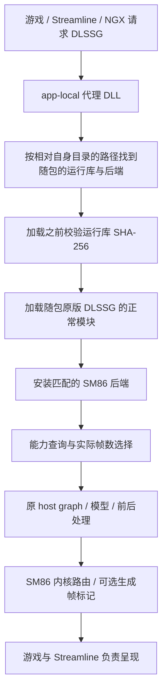

# 融合版执行架构

## 默认执行路径



`Bundled` 直接选择随包的运行库（`dlssg_sm86\runtime\nvngx_dlssg.dll`）和适配层（`dlssg_sm86\backend\sm86_backend.dll`；2026-09-29 前两者都内嵌在代理里）。游戏 A 的 310.1 请求与游戏 B 的 310.2 请求进入同一套计算实现，不需要分别给游戏自带文件配置后端。

游戏仍负责提供颜色、深度、运动矢量和其他参数。输入参数协议、D3D12 资源和呈现集成必须兼容；内置计算运行库不能消除所有游戏接口差异。

## 源码和构建分工

以下路径相对于独立项目根目录：

兼容性不变量（谁在什么条件下必须做什么）统一在 **`docs/COMPAT.md`**：一行一条，带现象、根因、代码位置和钉住它的测试。
**新增任何兼容性修复都要同时加一行账本和一个测试。**

`src/` 按"编进哪个二进制"分目录（2026-10-04 起）：

| 目录 | 内容 | 编进 |
|---|---|---|
| `src/proxy/` | `loader.cpp`、`loader/{log,arch_spoof}`、`file_hash`、`proxy_forward.h`、`ini_parse.h`、`ini_engines.h`、`runtime_request.h`、`generated/<name>/proxy.*` | 六个代理 |
| `src/common/` | `mod_api.h`、`bridge.h`、`kernel_selection.h`、`frame_limits.h`、`sr_options.h`、`device_class.h` / `device_sm.h`、`sr_gate.h`、`spoof_policy.h`、`plugin_identity.h`、`runtime_identity.h` | 代理与后端 |
| `src/backend/ngx/` | `fg_gate`（NGX 核心导出的唯一跳板）、`ngx_dispatch.h`、`param_store.h`、`requirements_status.h`、`ngx_abi.h` | 后端 |
| `src/backend/diag/` | `capture`（含 CaptureSR）、`mfg_probe`、`drs_probe`、`marker`、`frame_timing`（`[Logging] FrameTiming`） | 后端 |
| `src/backend/runtimes/` | `310_9_x/`：两个运行库模型（310.9.16、310.9）共用的 `backend.cpp` + `profile.h` | 后端 |
| `src/backend/xefg/` | `[FrameGeneration] Engine=XeSS` 的引擎：`xefg_engine`、`xefg_images.h`、`xefg_handles.h`、`xefg_limits.h`、`xefg_m15_routes.h`；不构建引擎时是空桩 `xefg_absent.cpp` | 后端 |
| `src/backend/fg/` | `jit_cache.{h,cpp}`、`variant_registry.h`、`asset_sources.h`、`fg_identity.h` | 后端 |
| `src/backend/snippet/` | `sr_310_7/`（超分路线，含 `route.h`、`net_profile.h`、`set_choice.h`、`shader_registry.h`、`weight_buffers.h`、`sr_sha.h`；2026-10-09 前光线重建的 `rr_310_9/` 也在这一层、共用这几个头，随路线删除，`docs/RR.md`） | 后端 |
| `src/pack/` | `fg_manifest.h`（帧生成内核包清单）、`set_summary.h`（超分闸门摘要与 `locate()`）、`sr_pack.h`（超分内核包 DLL 的清单与整包接受）、`kernel_set.{h,cpp}`（超分完整集合） | `set_summary.h` 两边，其余后端与测试 |

`#include` 写相对 `src/` 的路径（`"common/mod_api.h"`），同目录的头只写文件名。`src/pack/` 是包的读取器源码，不是内核包或它的生成输入。

| 文件/目录 | 职责 |
|---|---|
| `src/proxy/loader.cpp` | 代理本体：DllMain、系统导出转发、代理角色选举、LoadLibrary 拦截、INI 解析、运行库选择与后端安装 |
| `src/proxy/loader/log.{h,cpp}` | 代理的 JSON-lines 日志与级别，以及"相对路径相对代理自己的目录"这条规则。**绝不能在 loader lock 下调用**（它建目录、开文件） |
| `src/proxy/loader/arch_spoof.{h,cpp}` | `[Compatibility] SpoofArchToGame` 全套：导出表重定向、五个武装点、延迟记录队列、按调用方模块记一次、排除 NVIDIA 自己的组件。它**不读 settings**——重定向发生在 INI 能被解析之前，所以由 kernel32 早读（`peekSpoofPolicy`）一次决定整个进程；解析完之后 `settingsParsed()` 只把完整解析的结果与早读比较，不同就记一条 Level 1 `spoof_policy_mismatch`、什么都不改（2026-10-19 起；`docs/COMPAT.md` C5–C8） |
| `src/common/spoof_policy.h` | 上一条的判据本身：哪些调用方按**位置**排除（纯函数，CTest `spoof_policy`） |
| `src/proxy/ini_parse.h` | INI 值的语法（纯函数，CTest `compat_ini`，C4）。非法或越界的值不换成默认值、不钳位：记 `configuration_invalid`，该键所属的功能组不启用（分组在 `ini_engines.h` 的 `iniGroupOf`，C97） |
| `src/proxy/ini_engines.h` | 两个插帧引擎的 INI 布局：搬家键的新旧位置与旧名告警、`[FrameGeneration] Engine`、按实际引擎检查 `MaxGeneratedFrames`（超过引擎上限时帧生成不启用，不钳位：`engineFrameCeilingExceeded`）、另一个引擎的键 `ignored`、`[XeSSFG]` 的值、非法值的功能组（`iniGroupOf` / `iniDiagnosticOf` / `iniInvalidEffect`）（纯函数，CTest `compat_ini`，C84、C97）。节：公共 `[General]` / `[FrameGeneration]` / `[Logging]` / `[Runtime]` / `[SuperResolution]` / `[Debug]`，DLSS 专用 `[DLSSG]`（另有 `[FrameGeneration]` / `[Compatibility]` 里原位不动的 DLSS 专用键），XeSS 专用 `[XeSSFG]` |
| `src/proxy/runtime_request.h` | 哪一次 LoadLibrary 是我们的（运行库 / 超分 snippet / NVAPI / Streamline 插件），以及 `[Runtime] Mode` 的决定（纯函数，CTest `compat_runtime_request`，C9） |
| `src/proxy/file_hash.{h,cpp}` | `hashFile()`：随包文件与游戏自带运行库的 SHA-256。原 `src/bundle.cpp` 的内嵌资源读取、用户缓存与按部件释放 2026-09-29 删除（COMPAT C56） |
| `src/backend/runtimes/310_9_x/backend.cpp` + `profile.h` | 310.9.x 私有接口适配、SM86 内核路由、能力和 Evaluate；运行库 SHA 与全部钩子 RVA 只在 `profile.h`（`RuntimeProfile`，310.9.1.0 与 310.9.16.0 两条，安装时按原 DLL 的 SHA-256 选一条；310.9.0.0 那条 2026-10-26 删除，C119） |
| `src/pack/set_summary.h` | 超分包的闸门摘要 `gate_summary`（由包的生成器写入：内核包 `sr_kernels.dll` 的 INDEX 资源，或目录包的 `index.json`）与 `locate()`（`[SuperResolution] KernelSet` 落到包 DLL 还是目录）：代理的设备闸只读它，后端用 `kernelSet::summarize()` 得出同样的事实（`docs/PACK_FORMAT.md` 第二、三部分，COMPAT C73） |
| `src/pack/sr_pack.h` / `src/pack/kernel_set.{h,cpp}` | 超分内核包 `sr_kernels.dll` 的 MANIFEST 读取器与整包接受 / 拒用（`srPack::open`），内核集读取器与它的 `Source`（文件系统或包 DLL 的资源，`openKernelSets`）；只编进后端（`docs/PACK_FORMAT.md` 第三部分，COMPAT C79） |
| `src/backend/diag/marker.cpp` | 在生成输出上绘制可选帧标记 |
| `src/backend/diag/capture.{h,cpp}` | `[Debug] Capture`：游戏抓取（参数/输入/输出 → 磁盘），`Capture=0` 时完全不存在 |
| `src/common/kernel_selection.h` | 根据 KernelImage、真实 SM、路由状态与内核族（`Router`）选择 cubin/PTX |
| `src/backend/fg/jit_cache.{h,cpp}` | RTX 40（PTX 一族）的 PTX → cubin 缓存：安装时后台 cuLink 编译，`%LOCALAPPDATA%\DlssgSm86\jit`，跨进程复用（C128）；RTX 50 上不启用（`kernelFamily::cubinCacheUsable`，C131）；2026-10-26 前这一行是 `kernel_fallback.h`（cubin 被拒改用 PTX），已删除（C127） |
| `src/backend/fg/variant_registry.h` | 内核句柄登记表：句柄 → (源 RVA, 是否路由, 变体集)，每次创建重置、每次查询带上源 RVA（驱动会回收句柄，见下） |
| `src/common/mod_api.h` | 后端 ABI 1，`DlssgMod_GetInfo / DlssgMod_Install`；`ModBackendInfo` 按 `size` 只追加，2026-10-04 起末尾带内核包的结论（COMPAT C72） |
| `src/proxy/generated/<name>/` | 代理导出与 MASM 跳板（`scripts/generate_proxy.py` 生成；2026-10-04 起不再有任何内核表） |
| `src/pack/fg_manifest.h` / `src/backend/fg/fg_identity.h` / `src/backend/fg/asset_sources.h` | 帧生成内核包的清单读取器（纯）、"运行库 blob 身份 → 本进程 RVA"的安装时扫描、包的映射与整包接受 / 拒用闸门（`docs/PACK_FORMAT.md`，COMPAT C72） |
| `cmake/BuildIdentity.cmake` | 核对运行库 SHA-256，生成加载器闸门用的 `build_identity.h` 与 `build_manifest.json`；不内嵌任何东西 |
| `cmake/Package.cmake` | 验证产物与报告哈希，生成 manifest 和 ZIP |

CMake 分别生成 `sm86_backend.dll`、内核包 `fg_kernels.dll`、超分内核包 `sr_kernels.dll` 与六个代理；代理不内嵌任何载荷，安装时与运行库、后端、内核包一起放进发布树。内核包由它的生成输入（清单 + 资源脚本）编成只有资源的 DLL（CMake 目标 `fg_kernels`）；检出里没有这些输入时不建这个目标，由 `-DDLSSG_KERNEL_PACK`（`build.ps1 -KernelPack`）指定一个同模型发布里的 `fg_kernels.dll`。超分内核包同理（目标 `sr_kernels`，输入 `pack/sr/`（私有）由 `scripts/perf/sr_pack.py`（私有）写出）；没有输入时不建也不装，发布树里就没有超分内核包，打包时也就不带 `dlssg_sm86\sr`（2026-10-11 起发布 zip 带这个包与超分 snippet 这一对，`cmake/Package.cmake`；只有其中一个时打包失败）。资源文件与二进制按配置生成在构建目录（`build.ps1` 默认 `out/build-310.9.16`），源码目录没有构建输出。

**代理是同一份源码编译六次**（version 在发布根目录，winmm / dbghelp / dinput8 / dxgi / d3d12 在 `alternatives\`；用户一次只放一个，`docs/COMPAT.md` C80），而且它的 DllMain 跑在 loader lock 下、可能在 64 KiB 保留栈的线程上。因此 `src/proxy/loader/` 里的每个翻译单元都只允许**常量初始化或函数内静态**：谁都不能依赖另一个单元的动态初始化已经跑完。`setup_small_stack` / `proxy_small_stack` / `proxy_standby` 三个 CTest 就是这条约束的守卫。

| 随包文件（相对代理自己的目录） | 内容 |
|---|---|
| `dlssg_sm86\runtime\nvngx_dlssg.dll` | 未修改的原版运行库，含模型、host graph 和前后处理（2026-09-29 前是代理里的 RCDATA 30001） |
| `dlssg_sm86\backend\sm86_backend.dll` | 适配逻辑，不带任何内核镜像（2026-09-29 前是 RCDATA 30002；2026-10-04 前还带着内核镜像与内核表） |
| `dlssg_sm86\kernels\fg_kernels.dll` | 帧生成内核包：`MANIFEST` + 全部镜像（`docs/PACK_FORMAT.md`） |
| `dlssg_sm86\sr\nvngx_dlss.dll` | 未修改的超分 snippet 310.9.16.0（`[SuperResolution]` 介入时替换游戏请求的那份；`docs/SR.md`） |
| `dlssg_sm86\sr\sr_kernels.dll` | 超分内核包：`MANIFEST` + `INDEX` + 设备闸能放行的四套 INT8 集合的全部文件（`docs/PACK_FORMAT.md` 第三部分；2026-10-11 前是 `index.json` + 六个集合目录共 931 个散文件） |

内核镜像全部在内核包 `dlssg_sm86\kernels\fg_kernels.dll` 里（2026-10-04 起；后端不带任何镜像），资源号只在包内有意义
（号段沿用改动前的分配；近似行与细节行的号段见 `docs/PACK_FORMAT.md`）：

| RCDATA ID | 内容 |
|---|---|
| 1000+ / 2000+ | SM86 内核族：310.9.1 与 310.1 逐字节相同的 44 个原厂内核的 `sm_86` cubin / PTX 容器（沿用 310.1 的槽位号，落在 1000..1071 / 2000..2071 里） |
| 8100+ / 8000+ | SM86 内核族：310.9.1 新增的 26 个内核 |
| 3000+ / 4000+ | 34 个重写的 SM86 优化变体（2026-10-21 之前 60 个，C102） |
| 9100+ / 9000+ | 310.9.1 三个图像内核的补丁（`ImagePatches`，见下） |
| 6000+ / 7000+、13100+ / 13000+ | SM75 内核族：同样 70 个内核的 `sm_75` cubin / PTX 容器 |
| `MANIFEST` | 清单（JSON）：每个内核的 blob 身份、入口名、角色与两族镜像号，变体 / 补丁 / 近似 / 细节行 |

两族按内核一一对应，**SM75 的资源号 = SM86 的资源号 + 5000**，每个内核的两族镜像号写在清单的 `images` 里（原样导入的第三族 `75-original`、资源号 12000+i / 12100+i，2026-10-22 随 `[Compatibility] SM75Family` 删除，C102）。内核由原运行库里的 blob 决定，所以两族共用同一组 70 个内核，只有镜像号不同。CTest `sm75_resources` 在每次构建时解析内核包里 44 个共享内核与全部变体的 SM75 资源（修复族 + 优化族）：cubin 必须是 `e_machine=190` 且 `e_flags` 的 SM 字段为 75，fatbin 必须是单条未压缩的 `kind=1` PTX 容器、架构字段 75、含 `.target sm_75`，`.visible .entry` 名字必须落在该内核允许的入口名里，大小与 SHA256 必须等于生成时的索引；26 个新内核与三行补丁的 sm_75 镜像由 CTest `kernels_3109_registry` 按各自的索引同样核对。这两项是防止错位或错架构 blob 的唯一自动防线。

SM75 内核是原厂 PTX 的文本重写（`mma.m16n8k16` → 两条 `m16n8k8`，`max/min.f16x2` → f32 路径），修好导入时的 `.local` 缺陷之后在 3070 前向 JIT 上**与 SM86 族逐位一致**。34 个优化变体另有一份 `sm_75` 族（资源号 cubin 10000+ / PTX 11000+，清单 `variants[].images["75"]`），状态机与合并本身与架构无关，所以 SM75 路由跑的是同一套优化集；310.9.1 新增的 26 个内核与三行图像补丁的 `sm_75` 镜像由各自的 sm_86 PTX 精确重定向而来，所以 34 个变体行与 3 行补丁全部有 `sm_75` 镜像。`sm75_route_limits` 记的就是这条路线实际开了什么、少了哪几行（`variant_rows=37`、`variant_rows_unavailable=0`；缺行时另配一条 `variants_unavailable_sm75`）。

默认运行库为 310.9.16.0（SHA256 `cadee1aa…bba1bea72`），备选模型为 310.9.1.0（`ff6e90eb…e170b82`，见下一节）。构建时检查这个哈希（`cmake/BuildIdentity.cmake`），加载器在映射随包文件之前再校验一次（不符就不映射，记 `bundled_runtime_unavailable` 并拒绝这次加载，COMPAT C99）；后端侧它与全部钩子 RVA 在 `src/backend/runtimes/310_9_x/profile.h`。后端没有构建期哈希（签名会改它的字节），配对靠 `DlssgMod_GetInfo` 握手（COMPAT C10b）。

后端仍绑定其配套 DLL 的内部函数 RVA、对象布局和输出状态约定，但这个配对由包自身满足；内核不再编入后端，按运行库 blob 的 SHA-256 + 字节数从内核包解析，安装时扫描已加载的运行库得到本进程的 RVA（`docs/PACK_FORMAT.md`）。更换内置模型应将运行库、后端和验证结果一起更新。

## 两个运行库模型（默认 310.9.16）；加一个运行库要做什么

**2026-10-14 起有两个模型，默认是 `310.9.16`**（业主决定；出厂预设 `A`，预设 C 可选）：随包的 `nvngx_dlssg.dll`
310.9.16.0（SHA256 `cadee1aa6db3907babdc3285da2aebc4553d92b89c38ba3eae8abd8bba1bea72`，7,506,544 字节，`SizeOfImage 0x744000`）。
它与 310.9.1 共用同一份后端源码（`profile.h` 里两条 `RuntimeProfile`，按 SHA 选），71 个内核 blob 里 68 个与 310.9.1 逐字节相同，
`Kernel_BlendCandidatesFused`、`Kernel_DownsampleRGBAndEstimateUIFused` 有改动，`Kernel_BlendCandidatesFGLite` 是新的（预设 C /
FG Lite，`profile.h` 的 `liteGroup`），三个都由 `scripts/generate_310916_kernels.py`（私有） 从运行库自己的 sm_120 PTX 重定向到 sm_86 / sm_75；
图像补丁 P7 由 `scripts/perf/patch_image_310916.py`（私有） 在新 `Kernel_BlendCandidatesFused` 上重推（另两个补丁行的 blob 不变、与 310.9.1 共用），
`CatmullRomWarp` 的行挂在 310.9.1 的旧内核上，这个模型的内核包里没有。默认预设下两版输出逐位相同。

备选模型 `310.9`：随包的 `nvngx_dlssg.dll` 是 310.9.1.0（SHA256 `ff6e90eb78b827927dff5b4ecc6b1c870c2e9bca29ed9f48c7d348cc9e170b82`，
FileVersion 310.9.1.0，7,460,976 字节，`SizeOfImage 0x737000`），原生把 `DLSSG.MultiFrameCountMax`
报成 5（6X）；本项目的上限 `kMaxGeneratedFrames` 也是 5（`src/common/frame_limits.h`）。`[FrameGeneration] MaxGeneratedFrames`
高于 5 是加载器的 `configuration_invalid`（C97）；后端不再核对（C123；2026-10-19 之前用 `clampGeneratedFrames()` 夹住）。原来的 310.1 模型（310.1.0.0，只能报 3）于 2026-10-05 退役，它的后端与内核包已从源码树删除。
310.9.1 有 70 个内核 blob，其中 44 个与 310.1 逐字节相同，26 个是新的；DL1/DL2 网络的启动序列与 310.1 一致，
所以全部融合照旧适用（融合按清单里的角色认内核，安装时解析成本运行库的 RVA）。

**"一个运行库一个后端"**：加载器按 `DlssgMod_GetInfo.runtimeSha256` 把后端与运行库配对，不等就不安装（COMPAT C10b）；
后端只报一个 SHA，即本构建随包的那一个（CMake 经 `DLSSG_BACKEND_RUNTIME_SHA256` 编进去：310.9.16 构建报 310.9.16.0，310.9 构建报
310.9.1.0），内核包的 `model` 也必须等于 `DLSSG_BACKEND_MODEL`。
所以 310.9.16 的构建遇到游戏自己带的 310.9.1：`Bundled`（出厂）根本不加载游戏那份；`Pinned` / `External` 指向它则拒绝这次加载
（2026-10-20 起，COMPAT C99；此前回退到随包的 310.9.16，C82）。`Auto`（装进游戏自己那份）在 0.4.0 删除：它唯一与 `Bundled` 不同的结果是 `unsupported_runtime`、
游戏保留自己的 DLSS-G；旧值按 `Bundled` 运行并告警。`Pinned` / `External` 只能指向本构建的运行库（2026-10-22 `[Backends]` 删除，C102），
所以 `Preset=C` 与运行库选择不再可能冲突（2026-10-20 到 10-22 是 `configuration_conflict`，之前是 `preset_runtime_override`）。
`Bundled` 加载的是随包、且 SHA-256 等于构建时配置的那个运行库（门禁见上）。所以不需要 `[Runtime] Model` 一类的键。

模型由 CMake 变量 `DLSSG_RUNTIME_MODEL`（`build.ps1 -RuntimeModel`）决定，取值 `310.9.16`（默认）或 `310.9`。它决定的是：

| 决定项 | `310.9.16`（默认） | `310.9` |
|---|---|---|
| 运行库文件 | `${DLSSG_RUNTIME_310916}`（`build.ps1 -Runtime310916`，默认 `assets/runtime/nvngx_dlssg_310.9.16.dll`（私有）） | `${DLSSG_RUNTIME_3109}`（`build.ps1 -Runtime3109`，默认 `assets/runtime/nvngx_dlssg_310.9.1.dll`（私有）） |
| `cmake/BuildIdentity.cmake` 的 SHA 门禁 | `cadee1aa…bba1bea72` | `ff6e90eb…e170b82` |
| 后端目标 | `sm86_backend`：同一份 `src/backend/runtimes/310_9_x/backend.cpp`，`DLSSG_BACKEND_MODEL` / `DLSSG_BACKEND_RUNTIME_SHA256` 按模型编入 | 同左 |
| 内核包目标 | `fg_kernels`，输入 `pack/fg/310.9.16/`（私有）（71 个内核、34 个变体、3 个补丁、3 个近似行、0 个细节恢复行） | `fg_kernels`，输入 `pack/fg/310.9/`（私有）（70 个内核、34 个变体、3 个补丁、3 个近似行、2 个细节恢复行（`CatmullRomWarp`）） |
| `build_manifest.json` / `manifest.json` | `runtime_model 310.9.16` | `runtime_model 310.9` |
| `build.ps1` 构建目录 / 安装目录 | `out/build-310.9.16`、`dist/Release-310.9.16` | `out/build-310.9`、`dist/Release-310.9` |
| 发布 zip | `dist/dlssg-release-0.4.0-x64.zip`（+ `.sha256`） | `dist/dlssg-release-0.4.0-x64-310.9.zip`（+ `.sha256`） |
| 只在本模型注册的 CTest | `fg_pack_identity_310_9_16` | `fg_pack_identity_310_9`、`kernels_3109_registry`、`image_approx_registry`、`detail_restore_registry` |

两个模型都是：运行库文件是 NVIDIA 第三方材料，**只入私有仓库**（`assets/runtime/`（私有），2026-10-22 起；开源仓库没有）。私有检出（有
`pack/fg/<模型>/fg_kernels.rc`（私有）或 `src/backend/xefg/xe_graph.inc`（私有））缺运行库或 XeSS-FG 资产时配置直接 `FATAL_ERROR`，写明文件、
期望 SHA-256、缓存变量与仓库里的位置；`-DDLSSG_ALLOW_INCOMPLETE=ON` 只为纯 C++ 工作放行（告警，照常构建、测试，打包那一步拒绝）。开源检出缺文件照样构建，
只是发布树里没有运行库（`Mode=Bundled` 记 `bundled_runtime_unavailable`）；文件在而哈希不符一律 fatal。超分内核包 `sr_kernels`（`dlssg_sm86\sr\sr_kernels.dll`）与运行库模型无关，
只跟着 snippet 310.9.16（C90）。CMake 缓存默认值改成 310.9.16 不影响已配置过的目录：它们的 `CMakeCache.txt` 保留原来的模型。

缓存里还写着 `310.1` 的构建目录（以前的 `out/build`）在配置时就停下，并说明怎么办：删掉那份 `CMakeCache.txt`，
或传 `-DDLSSG_RUNTIME_MODEL=310.9.16`（或 `310.9`）。

加一个运行库（`DLSSG_RUNTIME_MODEL` 的下一个取值）要做的事：

1. **钩子表**：新构建的一条 `RuntimeProfile`，用 `scripts/analysis/hooks_3109.py --markdown <nvngx_dlssg.dll>` 从运行库本身推出（同一套做法在 310.1 上复现了那一代后端手写的全部 11 个常量），放进钩住它的那个后端的 `profile.h`，这个后端的 `DlssgMod_GetInfo` 报它的 SHA-256；安装时按原 DLL 的 SHA-256 选中（`profileForSha256()`），未知 SHA 或 `profileConsistent()` 不成立就拒绝安装。
2. **模型表**：`CMakeLists.txt` 顶部的模型表加一行（运行库文件、SHA-256、版本、后端源码），`build.ps1` 的 `-RuntimeModel` ValidateSet 加上这个值。
3. **内核包**：这个模型自己的内核包，输入（清单 + 资源脚本）由各内核的资产索引生成。清单按运行库自己的 blob（SHA-256 + 字节数）认内核，不按 RVA；`model` 必须等于读它的后端，运行库里每个 blob 都必须在清单里，否则整包拒用（`docs/PACK_FORMAT.md` 的"内核身份"与"闸门、拒用与日志"）。
4. **已知运行库表**：`src/proxy/runtime_request.h` 的 `kKnownDlssgRuntimes` 加上它的 SHA-256 与版本，`[Runtime] Path` 指错文件时日志才叫得出那是哪个构建。
5. **外部接口**：`tests/golden/surface.json` 加这个模型的后端导出表（CTest `compat_surface`；在这个模型的构建树里跑一次它失败时打印的 `--update` 命令，文件里别的模型的表保留）。
6. **测试**：这个模型内核包的无 GPU 测试——真包对真运行库按身份完全解析（现有的是 `fg_pack_identity_310_9`）、清单列出的每个镜像都在包里且大小与哈希一致、每个 sm_75 镜像逐个解析。它们要内核包的生成输入，只在有这些输入的检出里注册。

### 310.9 后端：profile 与内核身份

后端 `sm86_backend` 由 310.1 后端演变而来，运行库常量全部是安装时按原 DLL SHA 选出的
`RuntimeProfile` 字段（`src/backend/runtimes/310_9_x/profile.h`，310.9.1.0 与 310.9.16.0 两条；未知 SHA 拒绝安装，
`profileConsistent()` 不成立也拒绝）。另外三点：

1. **内核清单**来自内核包（`docs/PACK_FORMAT.md`）：70 个内核按 blob 身份登记，安装时扫描已加载的
   运行库得到它们在本进程里的 RVA（`src/backend/fg/fg_identity.h`）；创建钩子照旧按 blob RVA 查表。
2. **没有 RVA 重映射**：变体行与融合要认的内核（角色
   `upscale` / `element_wise` / `initial_merge` / `pooling` / `central_block`；`chain_block0` / `chain_flush` 2026-10-21 随
   `ChainBlock0` / `LaunchChains` 删除）都按源内核的
   身份写在清单里，安装时直接落到 310.9.1 的 RVA（`buildPackTables()` / `buildRowTables()`）。内核包里有 34 个
   变体行——310.1 的两个图像补丁和纹理探针挂在 310.9.1 删掉的内核上，不在包里——所以
   `image_patches.dropped_variant_rows` 是 0。310.9.1 自己的图像补丁在清单的 `patches` 段，按同样的身份规则落位（见下）。
3. **只钩 CU 的三个桩** `CreateCuModule` / `CreateCuFunction` / `LaunchCuKernelChain`。四个 CreateCubin thunk 与 `LaunchCubinShader`
   运行库从不经它们建或发内核（只有两次空参探测，答 −14），2026-10-26 起不钩（C120）。

**实测结论（RTX 3070）：310.9.1 完全不走 `LaunchCubinShader`。** 每个内核都由 `CreateCuModule` +
`CreateCuFunction` 创建、由单条目 `LaunchCuKernelChain` 提交。所以替换必须覆盖 CU-module 路径（原厂 blob
是 sm_89，Ampere 上 `CreateCuModule` 直接返回 `NVAPI_ERROR`）。整张钩子表可以用
`scripts/analysis/hooks_3109.py --markdown <nvngx_dlssg.dll>` 重新打印。

### 310.9 后端：CU 路径上的变体创建与融合（阶段 B2）

整套优化路径（37 行变体表、6 种跨内核合并、持久化残差链）**与 cubin 路径共用同一个状态机**（`optimizedLaunch()`），
只把创建点和提交点换到 CU 接口上。三处改动，全部在 `src/backend/runtimes/310_9_x/backend.cpp`：

1. **创建：`hookCuFunction`**（不是 `hookCuModule`——CU 模块没有入口名）。原始函数创建成功且该模块的 blob 被
   替换过时，`bindShader(function, rva, routed)` 把 **CU 函数句柄**登记为状态机的 RVA 键（不被替换的、以及
   模块根本不认识的那些函数**也要登记**，只是登记成"什么都不是"——见下面"内核句柄会被驱动回收"；入口名不是清单
   为那个模块列出的名字时，2026-10-16 起（`docs/COMPAT.md` C93）是 `fg_kernel_fatal{kind:"cu_entry_mismatch"}` 并结束进程，此前登记成"认识但没替换"、记 `cu_function_unrouted`），然后
   `createCuVariants()` 对该 RVA 登记的每一行变体各建**一对** `CreateCuModule` + `CreateCuFunction`
   （镜像按 `KernelImage` 选 cubin 3000+ 或 PTX fatbin 4000+），并对每个变体句柄调 `rememberBlob()`
   ——`emitChain()` 由此取回设备句柄来建持久化链的同步缓冲。每台设备上同一个源 RVA 只建一套（`variantsByRva`，
   键是 `(device, 源 RVA)`）：同一内核之后的每个新函数句柄——同一特性里的再次创建，或下一个特性——都绑到这一套上
   （`optimized_rebind`），既不重建也不落空。变体也会触发 observer 回调，
   GPU 工具的日志里因此能看到变体入口名与源 RVA。
2. **提交：`hookCuChain`** 遍历链里的**每一个条目**（310.9.1 今天恒为 1，但 API 允许多条，循环保证
   “一次提交 = 一个槽位”这条融合与计时都依赖的前提继续成立），把 `(function, grid, block, dynamicShared,
   params, paramSize)` 交给原来的 `optimizedLaunch()`。`Optimized=0` 时这一层直接原样调
   `realCuChain`，行为与替换-only 的 B1 逐字节相同。原样转发的提交（不改写的整条链、改写时参数为空的条目）失败时
   与 `hookLaunch` 的直通一样计入 `failedLaunches` 并记错误级 `launch_failed{status,actual_sm}`（2026-10-05 起）；没有条目的链不算提交——那是运行库每次能力查询时探测这个接口在不在的调用，驱动按设计答 -14（`cu_chain_launch{entries:0}`）。
3. **发射原语只有一个**：`submitOne()` 发一条**单条目** `LaunchCuKernelChain`（C120）。CU 路径上 **block 是每次提交的参数**，所以
   `PendingLaunch` 多了 `block` / `shared` 两个字段：原始提交照抄拦截到的条目，变体用
   `variantBlock(row) = {row.blockX,1,1}` 且不要动态共享内存。重写出去的提交走的是 Detours 蹦床，
   不会再回到 `hookCuChain`，因此 `cu.chain_launches` 仍然只数运行库自己的提交次数。

（`[Compatibility] LaunchChains`——把若干条目攒成一条多条目链的实验项，5070 上慢 2–3 %、310.9 上有害——2026-10-21
删除，连同 cubin 路径上另建 CU 函数与 `flushChain`；`docs/COMPAT.md` C102。每次提交都是单条目。）

### 310.9 后端：310.9.1 自己的图像内核补丁（`ImagePatches`）

310.1 的两个 `OPT_PASSTHROUGH` 行和 `OPT_TEXPROBE` 行键在 310.9.1 删掉的内核上，所以不在内核包里；310.9.1 的
补丁是对它**自己**的图像内核重新推导的（源文本是 310.9.1 运行库里这三个内核的 PTX），登记在内核包清单的 `patches` 段，
资源号 **cubin 9100+、PTX 9000+**（+ 内核在 310.9.1 目录里的序号，避开 1000+/2000+/3000+/4000+/6000+/7000+/8000+/8100+/13000+）。

| 内核 | 310.9.1 RVA | 参数块 | 变换 | ptxas sm_86 -O3 |
|---|---|---|---|---|
| `Kernel_OutputPushFine` | `0x6ffd80` | 72 B | P1 按 hole mask 整块提前退出 + P2 4 组 rcp | 30 寄存器（原 31），0 spill，smem 2176 不变 |
| `Kernel_OutputPull` | `0x6e5a40` | 152 B | P3 位掩码 5×5 闭运算 + P4 4 个合并的 8 字节 mip 写入 + P5 8 组 rcp；2026-10-08 起 + P8 4 条 flow 读取（含像素位置、越界谓词、寻址）提到 halo 暂存屏障之前 + P9 `.minnctapersm 6`（只在 sm_86）+ P10 flow 解码与两次颜色 gather（8 次纹素读取、两次手写双线性、lerp）也提到屏障之前、gather 的寄存器改名 | 40 寄存器（P9 之前 48），每 SM 5 → 6 块，0 spill，smem 784 → 864；sm_75 行带 P8 与 P10、不带 P9，60 寄存器（Turing 每 SM 仍是 4 块，线程数先到上限）；档位 2 的 A6 叠在它上面，39 / sm_75 47 寄存器 |
| `Kernel_BlendCandidatesFused` | `0x675730` | 240 B | P6 5 组 rcp + P7 10 个合并的 8 字节写入 | 39 寄存器（不变），0 spill，smem 288 不变 |

三者的 `cmem[0]`（424 / 504 / 592 字节）与原内核完全相同，这是参数块——也就是启动 ABI——没被动过的机器可校验证据。
**`ptxas -O3` 本来就会做 rcp 强度削减和同分母的公共子表达式消除**：只做 P2/P5/P6 的 PTX 汇编出来的 cubin 与原
cubin **逐字节相同**，所以它们语义上正确但不应记入收益；真正改变 SASS 的是 P1、P3、P4、P7（2026-10-08 起还有 P8、P9、P10：纯重排（P10 另带寄存器改名）与占用率提示，逐位一致由 `hoist_flow_loads()` / `hoist_gathers()` 的断言与 3070 上的闸门共同保证）。
P3 的等价性除了"310.9.1 的闭运算块与 310.1 的 088 逐指令相同（屏蔽寄存器号后 diff 只差一条
`mov.u32 %r, Shared_NeedsInpainting`），而 310.1 的替换已在 72+ 张参考图上验证过位一致"之外，还在 CPU 上
对 102912 组 (20×20 掩码, 线程) 枚举验证过：模拟原 306 行布尔块与位掩码替换的结果完全一致。

后端一侧只有四处改动：

1. `buildRowTables()` 依次放入清单的变体行、细节行、未被替换的补丁行与武装的近似行（先 `reserve()`，
   因为变体集存的是指向这个 vector 里各行的指针），补丁行数记入 `image_patches.rows`。
2. `resolvePlain()` 只在 `ImagePatches=0` 时跳过 `OPT_PASSTHROUGH` 行，并且
   **保留原始 grid、block 与 dynamicShared**——补丁内核就是原内核的 PTX，启动 ABI 一致，只换句柄。
3. 纹理探针挂靠的那个内核 310.9.1 已经删掉，三行补丁的 `extra` 都是 0；对应的 `[Compatibility] HardwareBilinear`
   与路由位 20（`NO_HW_BILINEAR`）2026-10-21 删除（C102；键 2026-10-26 起不读，C113）。
4. 创建走的还是 CU 路径的 `createCuVariants()`，不需要任何特殊分支；变体表因此是 **37** 行
   （34 个网络变体 + 3 个图像补丁；2026-10-21 之前是 63 = 60 + 3，多出的是 `PlainVariant` 的备选实现与 block0 链），
   `variant_creates` 数的就是其中建成的。

CTest `kernels_3109_registry` 额外钉住这三行（读构建出的内核包）：kind 20、源内核必须是 310.9.1
新增的内核、入口名与清单一致（`CreateCuFunction` 按名取函数）、参数块字节数、资源号落在 9000+/9100+、0 spill，
以及包里两个镜像的 SHA-256 等于生成时记下的值。

`hookGPU` 在 **PopulateParameters、Evaluate 与 NGX CreateFeature** 三个区间里报告 Blackwell（`0x1b0`）。
CreateFeature 那一段是 310.9.1 决定单个特性的生成帧上限的地方（NGX feature descriptor 的 slot +1）；缺了它，
`MultiFrameCount > 1` 的每次 Evaluate 都返回 `0xbad00005`，无论 `DLSSG.MultiFrameCountMax` 上报成多少。

**`PopulateParameters` 有两层，说的时候必须分清**（两层都叫这个名字，参数个数与参数存储所在的寄存器都不同）：

| | 导出体 `NVSDK_NGX_D3D12_PopulateParameters_Impl` | 内部函数（`profile->populate`，我们钩的那个） |
|---|---|---|
| 参数 | **一元** `(params)` | 310.1 两个 `(deviceKey, params)`；**310.9.1 三个 `(deviceKey, context, params)`** |
| 参数存储在 | **`rcx`** | 310.1 `rdx`；**310.9.1 `r8`** |
| RVA | 导出表里（310.1 336 B、310.7 / 310.9.1 344 B） | 310.1 `0x26450`、310.7 `0x1a780`、310.9.1 `0x165d0` |
| 能不能钩 | **不能** | 能，这是我们钩的那一个 |

导出体不能钩的理由与 COMPAT **C11** 里 `CreateFeature` 的完全相同、而且是第二个独立例证：310.x 的导出体会
`mov rdx,[rsp+N]` 把**自己的返回地址**读出来当参数往下传（`CreateFeature` 是 `mov rdx,[rsp+0x2d8]`），
装了 trampoline 之后那个值就变成了跳板里的地址。所以"不能钩运行库自己的导出、只能钩内部 RVA"这条规则在
`CreateFeature` 与 `PopulateParameters` 上各有一份字节证据。
常说的"310.9.1 的 `PopulateParameters` 是三个参数、存储在 `r8`"，指的是**内部函数**那一行；
导出体两代都是一元、存储在 `rcx`（按逐版本的导出体字节核对过）。
（定位这个闸门用过的两个诊断环境变量 `DLSSG_GPU_CALLERS` / `DLSSG_MFG_ARCH_ANY` 2026-10-21 删除，C102；要再定位一个新
运行库的闸门，从 git 历史取回。）

### 310.9 后端：`[DLSSG] Preset` 在每个特性上钉住渲染预设（UI 重组、FG Lite）

驱动侧说的“预设 A / B”在运行库内部只是一个布尔量：**UI 重组**（preset B = 开）。它在 **NGX CreateFeature 内部一次性
解析**，来源是 `EndpointConfiguration` 里一个 0x14 字节的覆盖组，组的布局（构造函数 `0x34790` 与两处内联解析器逐条
反汇编确认，两个 310.9 构建完全相同）是：

```
config+0x50   { uint8 value; uint8 provided; } pairs[3];   // +0x50 +0x52 +0x54
config+0x56   uint8 pad[2];
config+0x58   uint32 order[3];                             // 构造函数写 {0,1,2}
config+0x64   uint32 appliedPresetId;                      // 0 无 / 1 = A / 2 = B
```

解析器**从 `order[]` 的末尾往前**扫，取第一个 `provided` 的 pair，全都没有就回落到 `pairs[0].value`，因此优先级是
`pairs[2]`（驱动 / NVIDIA App 的预设，DRS key `0x10E41DF1`）> `pairs[1]`（游戏的
`DLSSG.UserInterfaceRecompositionEnabled`）> `pairs[0]`（内置默认，构造函数写成 `{0, provided}`）。CreateFeature 里
的顺序是：构造局部 config → `presetSelect`（`0x340e0`）填全局 config 的 `pairs[2]` → 全局拷到局部（只拷 6 个
value/provided 字节和 `+0x64`，`order[]` 不拷）→ **`uirParam`（`0x33e80`，只有这一个调用点）填 `pairs[1]`** →
内联解析该组 → 结果存到 endpoint 对象的 `+0x12`（遥测端点名 `endpoint` / `endpoint_uir` 也看这个字节）。

所以后端只钩 `profile->uirParam`（`hookUirParam`）：**原函数返回后**把三对 value/provided 全部写成 INI 要求的值，
再把 `+0x64` 写成预设 id。2026-10-22 起（C102）这个钩子总是装，`A` / `B` / `C` 每个特性都钉（没有 `Auto`，没有
“不写就交给游戏 / 驱动”）；310.9.16 的 FG Lite 组（`liteGroup`，同样的布局）一起钉：`C` 写 1，`A` / `B` 写 0。这样

- 时序天然正确：钩子体就在 CreateFeature 里、在拷贝之后、在解析之前，而且没有任何东西会每次 Evaluate 重读；
- 结果与 `order[]` 无关（三对都写了），也与游戏的参数、驱动的 DRS 覆盖无关——这正是“INI 钉住”应有的语义；
- 唯一的安全依赖是结构布局。因此写之前先检查该组还是构造函数留下的样子（`pairs[0]` 已 provided 且 value ≤ 1、
  `order == {0,1,2}`；`pairs[1]` / `pairs[2]` 的 value 在 provider 写之前是未初始化的栈内容，不能检查）。不符合就记
  `preset_layout_unexpected`、**一个字节都不写**，并拒绝帧生成（这个特性和以后的都返回 `0xbad00001`）。布局只在进程第一次钉时判一次。

`presetSelect`（`0x340e0`）只记录在 profile 里做审计，不钩：它在我们之前运行、只写 `pairs[2]`，我们照样覆盖。
预设与内核替换/融合完全正交（只有 K39/K45/K53 三个图像内核换了 10 个纹理绑定和 4 个参数字，内核集合、发射顺序和
每个 index 的提交次数都不变），因此 `hookUirParam` 的安装不依赖 `active`，反过来融合状态机也不需要知道预设。

### 310.9 后端：RTX 40 / 50 的路线（2026-10-10；2026-10-19 起不可关）

运行库在 Ada（sm_89）与 Blackwell（sm_120）上原生就能跑，0.4.0 之前路线在这两代卡上不启用。现在它们也走本项目的内核
（业主决定）。2026-10-10 到 2026-10-19 有一个关闭键 `[Compatibility] AccelerateNewerGpus`（两位：15 / 31），2026-10-19 删除
（业主 Q8：RTX 40 / 50 一律跑本项目的内核，帧生成开不开只由 `[General] Enabled` 决定；两位退役，同位 27；键 2026-10-26 起不读，C113）。
判据与不变量在 `docs/COMPAT.md` C77，这里讲机制。

**运行库在不同架构上要什么。** D3D12 后端对象的 `getSM`（`profile->getSM`，`0x1b6c0`）把架构 id 映射成 75 / 86 / 89 / 90 / 120，
整个运行库只有一处用它：DL1 / DL2 网络类的选择（`0x4d9f0` 里两次 `cmp eax,0x59`）——SM < 89 是基类（运行库里那批 sm_86
cubin）、SM == 89 是 `Flatten_EndpointDL*Net_89`（sm_89 ELF cubin）、SM > 89 是 `Flatten_EndpointDL*Net_89_PTX`（sm_89 PTX，
包在 fatbin 容器里）。内核包按 **fatbin 容器**认 blob（`src/backend/fg/fg_identity.h`：310.9.1 里正好 70 个），认的是
`_89_PTX` 这一套加 26 个新图像内核。原生 RTX 50 答 120，本来就选 `_89_PTX`；原生 RTX 40 答 89，选 `_89`，那一套的创建对内核包
来说是"认不出的 RVA"。所以 `hookSM` 照旧答 90：RTX 50 上与原生同一个分支（什么都没变），RTX 40 上把运行库从它的 sm_89 cubin
挪到 PTX 那一类，替换才有对象。26 个图像内核的 fatbin 里有 sm_89 cubin、sm_89 PTX、sm_120 PTX：RTX 40 的驱动挑 sm_89 cubin
（Ada 版，为不做多帧生成的产品编的构建），RTX 50 的驱动 JIT sm_120 PTX；本项目的图像内核取自 sm_120 那份（C17）。

**装什么、不装什么。** `installBackend` 先判"原生路线"`newerGpus::nativeRoute`（SM86 / SM75 或 `ForceSM86Route`），
不是的话再判 `newerGpus::decide(flags, SM, 显卡名)`：SM ∈ {89, 120}、名字带 `RTX`、`KernelImage` 不是 `Original`。启用时 `active` 为真、`newerRoute` 为真，而 `archBridge`
（按**物理** GPU 判的原生路线）为假：创建钩子（`CreateCuModule` / `CreateCuFunction`）、
`LaunchCuKernelChain` 钩子与 `hookSM` 照装，**`hookMinimum` / `hookRequirements` 不装**，`hookArchInfo` 本来就只有
`SimulateAmpere`（要求 `ForceSM86Route`）或 Turing 主机才装，`turingHost` 也要求 `archBridge`。`hookGPU` / `hookPopulate`
由 `modConfigured` 与加载器的 `MaxGeneratedFrames` 武装；`hookGPU` 对运行库多帧闸答 Blackwell 的条件在内核包闸之后一次定死
（`multiFrame::decide`，`docs/COMPAT.md` C92）：原生路线照旧，RTX 40 / 50 只在我们的内核会跑（新路线启用、包已接受、镜像不是
Original）或 SM ≥ 120 时答。RTX 40 跑自带 sm_89 镜像（现在只有 `KernelImage=Original`）时运行库按真实架构只能 2X，2026-10-19 起
`MaxGeneratedFrames` > 1 时安装直接拒绝帧生成（`max_generated_frames_unsupported{reason:"runtime_kernels"}`，`refuseAtInstall`；
此前是 Level 1 `mfg_not_advertised` + 2X；2026-10-16 之前这里与路线无关、RTX 40 照样被抬到多帧，自带镜像的相位恒为 0.5，即 slaudit
的漏洞 B），RTX 50 照旧。安装之后没有任何东西能改变谁的内核在跑（C93），所以这个决定按构造就是终局。

**镜像。** 物理 SM 不等于内核族（86），`selectKernelImage` 选 PTX；显式 `KernelImage=Cubin` 这里没有 cubin 可用，安装时记
`kernel_image_unavailable{reason:"no_sm89_sm120_cubin"}` 并拒绝帧生成（2026-10-20 起，C99；此前悄悄改跑 PTX）——
`newerGpus::imageFlags()` 仍去掉那一位，只为让安装本身走完、由 fg_gate 拒绝（不然精确 SM 规则会在安装里抛出）。没有 sm_89 / sm_120 cubin：ptxas 13.0.2 把包里全部 148 个 sm_86 PTX（70 个内核、当时的 60 个
变体、3 个补丁、3 个近似行、12 个细节行；2026-10-21 之前）离线编成 sm_89 / sm_120 都是 0 失败、0 spill、0 警告，`Kernel_OutputPull` 的
`.minnctapersm 6`（P9）在两代上都还是 40 个寄存器（6 × 256 = 1536 线程正是 CC 8.9 / 12.0 的每 SM 上限），要发 cubin 的话
内核包多 4.0 MB（sm_89）+ 5.2 MB（sm_120）；业主定为只用 PTX，冷启动成本见 `docs/INSTALL.md`。

**没有安全网：安装 = 选定或失败，会话中途永不退化（2026-10-16，业主"内核选了就是选了 … 要么启用要么直接炸"，`docs/COMPAT.md` C93）。**
2026-10-16 之前这条路线有 `stopNewerRoute`：驱动拒绝我们的镜像 / 运行库建了包里没有的 blob 时，那个内核交回运行库自己的 blob，
本进程之后不再替换、`hookSM` 改答原生 SM（RTX 40 上就是运行库自带 sm_89 镜像跑 3X / 4X 的顿挫）。现在所有路线一样：
`prepare()` 认不出 blob / 入口名不对、`createRouted()` 的 cubin 与它的 PTX 都被拒、`createVariants()` 的任何一行被拒、
`hookCuFunction` 入口名不对、创建路径上的任何异常 → `fgFatal()`：一条错误级 `fg_kernel_fatal`，然后
`kernelFatal::raise()`（`src/backend/diag/kernel_fatal.h`：合成异常 `0xE0D55001` 交给崩溃记录过滤器写 `fg_gate_crash`，再
`TerminateProcess(0xE0D55001)`，栈上谁都接不住；不用 fail-fast，它在没有 WER 服务的系统上会卡死）。cubin → PTX 重试照旧（同一内核换容器）。安装时选中了我们的内核而内核包缺失 / 被拒：
`fg_kernels_unavailable`，fg_gate 对之后每次帧生成 CreateFeature 答 `0xbad00001`（`fg_feature_refused`），运行库自己的内核不顶替；
只有 `KernelImage=Original` 这个显式的诊断选择才让运行库自己的内核跑。超分 INT8 同一条规则（`srFatal`、
`sr_kernels_unavailable` / `sr_feature_refused`，见 C93）。

**诊断开关 `DLSSG_FAKE_HOST_SM=89|120`。** 让安装**按那个架构做判断**（`actualSM` 取它），而 `archBridge` 仍按物理 GPU：3070 上
于是能把这条路线完整跑一遍——没有 `ForceSM86Route`、没有 `SimulateAmpere`、`KernelImage=Auto`，包里的 sm_86 PTX 经驱动 JIT、
37 行与全部融合照常——而 NGX 核心照旧看到它需要的 Ampere 答复。`newer_gpu_route` 记录带 `fake_host_sm`。CTest 之外，
`tests/python/validate_kernel_selection.py` 的 `newer_gpus_*` 用例与 `check_scene` / 重放都用它（`docs/COMPAT.md` C77）。

日志：`newer_gpu_route`（只在非 SM86 / SM75 的卡上写：`engaged`、`reason`、`image`、`multi_frame_advertised`、
`architecture_bridges`、`frame_generation_refused`；`key` / `default_on` / `requested` 随键删除），`install.kernel_selection`（`ours` /
`runtime_by_choice` / `not_served` / `refused`）。`configuration.accelerate_newer_gpus` 随键删除；RTX 30 / 20 的日志与这条路线
存在之前相同。

## `[FrameGeneration] SkipRepeatedRealCopy`（2026-10-08 删除）

这个键曾是唯一一项流水线级的"优化"：后端用 Detours 钩住 `ID3D12GraphicsCommandList::CopyResource`（vtable 槽 17），在
`MultiFrameIndex > 1` 时吞掉运行库的全分辨率 `copy(ext_color -> ext_real)`（Backbuffer → `DLSSG.OutputReal`）。依据是
310.9.1 host graph 里 `ext_real` 只有这一个写者、没有读者，一组里第一次之后的拷贝都是死存储。

删除的原因：运行库只在调用方交出 `DLSSG.OutputReal` 时才发这次拷贝，而本机全部 Streamline `sl.dlss_g` 构建
（2.6.10–2.14.1，静态反汇编为同一段代码）只在 index 1 交出它、之后传空。所以在 Streamline 游戏里 index ≥ 2 根本没有
拷贝，钩子从来没有东西可吞：5 个游戏的抓取里 index ≥ 2 的 `OutputReal` 300/300 为空，三场开/关重放 `skipped` 恒 0，巫师 3
实机 3486 次 Evaluate 跳过 0 次。离线量到的"每真实帧 −58 / −193 µs"（3 个生成帧，1080p / 4K）只存在于 2026-10-08 之前
每个 index 都传 `OutputReal` 的 `sm86_scene` / `sm86_bench` 里（之后两者与 Streamline 一样只在 index 1 传）。0.3.2 把它放进档位 1 之后的绝区零闪屏（#532）因此也不是它造成的
（前提：绝区零那份 `sl.dlss_g` 是 NVIDIA 签名原版；`docs/COMPAT.md` C19）。

留下的东西：
- 加载器 2026-10-26 起不读这个键（C113；此前只为告警而读）。
- 路由标志位 27 退役、永不复用（`src/common/bridge.h` `SM86_BRIDGE_RETIRED_SKIP_REAL_COPY`）。
- `SM86BridgeStats.realCopiesSkipped` 保留（结构只追加、按 `size` 校验），恒为 0。
- 记录 `real_copy_skip` / `real_copy_pair` / `real_copy_skipped` / `real_copy_skip_other_vtable` / `real_copy_mismatch`、
  `install` 与 `configuration` 的 `skip_repeated_real_copy`、`evaluate` 的 `real_copies_skipped` / `real_copy` 都已去掉。

## `[Debug] Capture`：游戏抓取与离线重放（GCR）

把真实游戏里 DLSS-G 的输入、参数和输出录下来，在本机用任意运行库重放并逐帧比较。用法、目录格式、磁盘占用和判定标准
在 `docs/CAPTURE.md`；这里只写机制、线程和状态约定。

**分工**：loader 只解析 `[Debug] Capture*`（`CaptureInputs` / `CaptureOutputs` / `CaptureRingSlots` / `CaptureVramMB` 2026-10-22 删除，默认写死，C102），把相对目录
解析成绝对路径（纯字符串操作），然后通过**新的可选导出 `DlssgMod_ConfigureCapture`**（`ModCaptureOptions`，自带
size/abi 闸门）在 `DlssgMod_Install` **之前**交给后端。刻意不往 `ModOptions` 里加字段：每个后端都精确校验
`sizeof(ModOptions)`，不为一个调试功能改它。
GPU 和文件系统的每一步都在后端里，loader lock 上什么都不做。

**安装闸门**：`captureEnabled` 是 `active || modConfigured || … ` 之外**独立的一项**，Evaluate 钩子的条件里也加了它。
所以不替换内核（`KernelImage=Original`）的 50 系机器上也能录——那正是"原厂参考"的那一半。

**四个钩子**（都只在请求抓取时才装）：

| 钩子 | 目标 | 作用 |
|---|---|---|
| 参数存储的 getter | 驱动 `_nvngx.dll` 参数对象 vtable 的 8 个 getter 槽位（`+0x40..+0x78`） | 记录运行库**实际**读了哪些参数、按什么顺序、从哪个带类型的槽位 |
| CreateFeature | **NGX 核心**的 `NVSDK_NGX_D3D12_CreateFeature` 导出 | 记录创建期参数 |
| ExecuteCommandLists | `ID3D12CommandQueue` vtable slot 10 | 提交后打我们自己的 fence，用来判断抓取拷贝何时完成 |
| Evaluate | 后端本来就有的那个 | 抓取窗口的括号 |

三个非显然的结论都是实测出来的：

1. **不能钩运行库自己的 `NVSDK_NGX_D3D12_CreateFeature` 导出**。它把**调用方的返回地址**当参数往下传
   （310.1 的 0x21230：`push rbx/rbp/rsi/r14; sub rsp,0x2b8; … mov rdx,[rsp+0x2d8]` 正好取到入口帧的返回槽），
   Detours 的 trampoline 一挂上去，运行库看到的调用方就变成 `sm86_backend.dll`，特性创建直接返回 `0xbad00002`。
   改钩 NGX 核心的公开入口就没有这个依赖。代价是核心可能还没加载（两个 GPU harness 都是先自己 LoadLibrary 运行库、
   之后才加载核心），所以核心缺席时先钩住 `LoadLibraryW/ExW`，等它出现再补装。
   这个 trampoline 与那段延迟安装现在归 `src/backend/ngx/fg_gate.cpp`（始终安装，见下面的 fg_gate 一节），抓取只登记一个观察者，
   记录相应变成 `fg_gate_hooks` / `fg_gate_hooks_deferred` 加一条 `capture_create_hook{hook_owner:"fg_gate"}`。
2. **参数存储的 8 个 getter 槽位只有 7 个实现**：`+0x40` 与 `+0x48` 是同一个函数（8 字节/指针 getter），所以
   `+0x08` 是 8 字节 setter——浮点 setter 是 `+0x30`（`scene.cpp` 早就发现了；槽位类型见 `src/backend/ngx/ngx_abi.h`）。Detours 不能把同
   一个目标挂两次，所以共享分组在**活对象的 vtable 上**检测出来，只挂组里最低的那个槽位，记录里写出整组
   （`capture_parameter_hooks.slots[].owner`）。
3. **数值 getter 之间会转换**：用 `+0x20` 写进去的整数 3，`+0x58` 读出 3、`+0x70` 读出 3.0f、`+0x68` 读出 3.0
   （这也认出 `+0x68` 是 double getter）、`+0x78` 读出 `0x3`。因此"哪个 setter 配哪个 getter"不需要猜：重放按
   "经 `QueryInterface` 证实的对象指针优先 → 其次数值回答 → 最后才是裸指针回答（`buffer` 属于这一档，**不是**第一
   档）"选一个 setter，写完再把**每个被记录的 (名字, 槽位, 值)** 读回来逐项比对（`parameters.mismatches` 必须为空）。

**从哪一帧开始录**（`[Debug] CaptureStartOnReset`，默认 1，0/1/2 三个取值）：运行库的颜色历史不在抓取里，而**只有
"刚创建完特性之后的第一次 Evaluate"（`MultiFrameIndex<=1`，`evaluatesAtCreate+1`）历史是空的**——这就是为什么代理在
游戏启动时武装、玩家一开帧生成抓取就立刻开始，也是为什么在游戏里把帧生成关掉再打开能随时拿到一个合法起点。
**`DLSSG.Reset` 置位不等价**：实测一份在特性已跑 3169 次 Evaluate 之后的 `Reset` 帧上起录的悟空抓取，重放时每张生成图
只有 64.9–73.3 dB（`OutputReal` 逐位一致；同一份抓取重放两遍 70/70 张逐位相同，所以不是重放的不确定性）。所以
`2` 只认新建特性（逐位一致的唯一起点），`1`（默认）`Reset` 帧或新建特性先到先算，`0` 立刻开始。等待期间记
`capture_waiting_for_reset`，开始时每次都记 `capture_start_armed`（含 `reason` / `bit_exact_replay` / `start_mode` 与等掉了
多少次，并写进 `manifest.capture.start_reason`），等满 3 分钟记 `capture_start_timeout` 并什么都不录
（`manifest.json` 的 `capture.start_timeout`）。判断所需的全部状态都是原子量，因为它在调用 Evaluate 的那个线程上
决定、而那时还没拿环的锁。

**一次被录制的 Evaluate**（顺序即代码顺序）：

1. 探测（probe）：150 多个已知参数名 × 每个不同的 getter 实现，凡有回答就记下——这是"游戏侧状态"的权威快照，也决定
   了要抓哪些资源（任何被交出的 `ID3D12Resource`，除了两个输出，都算输入）。指针的分类是有防护的：`VirtualQuery`
   确认可读、首个 qword 必须指向某个已加载模块（真 vtable 的样子），才在 SEH 保护下做 `QueryInterface`；落在模块里
   的指针（回调）只记录、不复现。
2. 抓输入：在 `realEvaluate` **之前**把每个输入资源按 NGX 约定的状态（`NON_PIXEL_SHADER_RESOURCE`）转到
   `COPY_SOURCE`、`CopyTextureRegion` 进 READBACK 缓冲、再转回去。因此录到的就是运行库即将读到的字节。typeless
   纹理不能直接当"纹理 → 缓冲"拷贝的源，先 `CopyResource` 到同一拷贝组的有类型兄弟格式（`via_intermediate`）；
   多平面深度（R32G8X24_TYPELESS / D24_UNORM_S8_UINT）按 `planes*mips*arraySize` 逐平面走 footprint，buffer 参数用
   `CopyBufferRegion` 整块拷（小的在 Evaluate 前后各一次）；MSAA、子采样视频格式、其它维度跳过并记 `capture_plane_skipped`。
3. `realEvaluate`（有序读日志在此期间由 getter 钩子填充，窗口是 **thread_local** 且只认那一个参数对象）。
4. 抓输出：在融合刷出之后、调试标记之前，把 `OutputInterpolated` / `OutputReal` 从 `UNORDERED_ACCESS`
   （`marker.cpp` 一直依赖的同一个约定）转到 `COPY_SOURCE` 读回。
5. 完成检测：拷贝录在**游戏自己的命令列表**里，所以它们在那条列表执行完时才有效。
   `ExecuteCommandLists` 钩子按**命令列表身份**匹配还在等的槽位，在那个队列上打一次我们自己的 fence——比死盯
   `DLSSG.CmdQueue` 更准（游戏在别的队列上提交也对），`DLSSG.CmdQueue` 只用来拿到一个队列对象、从它取 vtable。
6. 落盘：一个 `BELOW_NORMAL` 的写盘线程轮询 fence，把紧排（无行距填充）的像素、SHA-256 和 `params.json` 写出去，
   同时增量重写 `manifest.json`。**游戏线程不等 GPU**，唯一例外是最后一次被录的 Evaluate 提交之后的一次收尾
   （`capture_done.drain_ms`，实测 25–120 ms），这样进程被立刻关掉也不会丢最后几张图。

**线程与背压**：4 个槽位的环，每个槽位独占自己的 readback 缓冲（按大小池化，第一次之后不再分配）。环满时游戏线程
最多等 2 秒（等待期间自己调用写盘的 `collect()`），超时才丢弃并记 `capture_slot_dropped`。**必须等而不能直接丢**：
1080p 一次 Evaluate 约 48 MB，写盘几毫秒，不等的话一组之内环就满了——最初的实现在 1080p 上 12 次里丢了 1 次，而且
丢的正好是最后一次，于是收尾也没触发、又跟着丢了 3 次。丢弃时也会 arm 收尾。`Capture=0` 时这一切都不存在：
1080p `run_bench` 实测每生成帧 1146 → 1147 µs。

**重放**（`tests/native/replay.cpp` → `sm86_replay.exe`）不装任何钩子：它按录下来的参数重建 NGX 参数存储、给**每个被
记录的资源指针**建一张纹理（指针相同就共用，因为运行库会比较指针判断"给了没给 HUD-less"）、上传录下来的字节、按
NGX 约定设好状态、`EvaluateFeature`、读回输出比较，并把自己的输出按抓取的目录结构写出来，于是两次重放可以用
`--compare-with` 相互比较。**运行库的内部历史不在抓取里**：起点不是"新建特性的第一帧"时生成图必然不同
（`CaptureStartOnReset=0` 或被 `--start` 跳过起点：第一帧 33 dB、第二帧 68–77 dB；`Reset` 帧起录：每张 64.9–73.3 dB；
`OutputReal` 一直逐位一致），重放会打印警告并把 `summary.first_is_new_feature`（新抓取直接读
`manifest.capture.start_reason`，老抓取由 `creates[].evaluates_seen+1 == params.evaluate_seen` 推出）与
`summary.capture_start_mode` / `capture_start_reason` 一起写进报告，逐帧判定照常给出。

参数复现里有一条**只靠抓取内容判断不了**的陷阱：存储的指针 getter 也会答数值参数（`+0x78` 把 float
`DLSSG.CameraPosY=400061.78125` 答成截断的 `0x61abd`），那个地址在游戏进程里恰好可读时会被分类成 `buffer`，重放照它
写一个真堆指针进去就毁掉这个参数（实测运行库读出 3.28e12、120 项参数读不回来）。所以抓取侧对"同名还答过数值
getter"的指针回答一律降级成 `opaque` + `reproducible:false`（`capture.h` 的 `demoteNumericPointerAliases`，无 GPU 的
`capture_options` 测试覆盖），重放侧的优先级也改成"**经 QueryInterface 证实的对象** → 数值 → 裸指针（含 `buffer`）"。
五个 4×4 矩阵只答指针 getter，所以仍然走最后那条回退。

## 内核句柄会被驱动回收（`src/backend/fg/variant_registry.h`）

优化变体按 `(device, 源 RVA)` 缓存，特性重建时只把已有的那一套**重新绑定**到新句柄上。
这里原来有一个隐含前提：重建拿到的是"全新句柄"。**不成立**——运行库释放上一代特性的内核之后，驱动从一个小池子里把同样的
句柄值发回来。现场日志（公开 issue #561，13 次特性重建）：941 条 `kernel_create` 只用了 454 个不同句柄值，其中 274 个
先后属于不同的源 RVA，112 个 CU 函数句柄先后承载过不止一行变体。

旧代码里 `variantsByShader` / `shaderRva` / `shaderByRva` / `cuFunctionRva` 从不擦除，而 `createVariants()` 只在
**新内核自己有变体行**时才改绑。于是一个被回收的句柄若落到那约 40 个"有路由但没有变体行"的内核上（`built.empty()` 直接
`return`），或者落到我们根本不替换的内核上（`hookCuFunction` 当时整段跳过），它就仍然指着**上一个内核的变体集**；
`resolvePlain()` 选行的唯一条件是 `paramBytes == bytes`，`findVariant()` 连这个都没有。结果是把另一个入口点、另一套
grid/block 的内核发射到新内核的参数块上：轻则输出错，重则 GPU 故障 / `DEVICE_HUNG`，而且要重建若干次之后才发作 ——
"玩一会儿就随机崩"正是那位报告者从 0.3.0（引入优化变体的那一版）起一直描述的现象。

**2026-09-19 在 3070 上实测到它真的会被选中**（`sm86_scene --recreate-every 2 --frames 32 --multi 3`，15 次特性重建，
640×384，`OptimizedKernels=1`，前向 JIT，96 次 Evaluate / 352 张图）：310.9 路线上未修复的构建跑四遍，优化发射次数是
1088 / 1093 / 1093 / 1091（**不确定**），其中三遍产出了与修复后不同的生成帧 —— frame_31 的三张（1115–1411 个像素、
最大分量差 141–182、PSNR 39.4–43.2 dB）和 frame_24 的三张（1777 个像素、最大 198、PSNR 29.97 dB），同一帧的输入与
三张真实帧逐字节相同；第四遍（1088 次）干净。修复后的构建跑三遍全是 1088 次、352 张图三遍逐位一致，而这三遍里句柄
被回收了 231–311 次、其中 117–143 次回来时还绑着上一个内核的变体集。多出来的那几次发射落在具体的 Evaluate 上：第
52/53/54 与 91/94 次各多一次，第 91 次修复后是 0 次、未修复是 1 次 —— 那正是"这个句柄现在的内核没有变体行"的情形。
同一实验在 310.1 路线上句柄同样被回收（28 次，其中 15 次还绑着变体集），但那几遍没有被选中：1040 次优化发射与 2851
张图老新完全一致。**句柄分配本身不确定**，所以这类实验只能证明"会发生"，不能用"这次没发生"证明安全。原始数据
（n9…o1 十次运行）留在开发机上，没有入库。

修法是一张登记表加两条规则：

- `bind(handle, rva, set, routed)` —— **任何一次创建都先抹掉这个句柄原来的含义**。有变体行的、有路由但没有行的、
  认识但没替换的、根本不认识的，四种创建全都调用它；非路由创建以 `rva=0 / routed=false` 登记，于是 `rvaOf()` 返回 0，
  与"原来根本没记过这个句柄"逐字节等价（不回收句柄的一次运行因此逐位不变，融合计数也不变）。同一张表还管反向的
  "这个 RVA 最新的句柄是谁"（`newestFor`，解码器 pair 融合要用），句柄换了主人就不再当选。
- 每一次查询都带上**这次发射的源 RVA**：`setFor` / `newestFor` / `select` 只认仍然代表该 RVA 的句柄，而 `select()`
  还会逐行比 `row->rva` —— 每一行的 `rva` 都是安装时按源内核身份解析出的本进程 RVA，变体、补丁、近似与细节行处在同一个 RVA 空间（`createVariants` 的
  `row.rva != rva` 就是这个空间），所以两者查得一样严。这道行级护栏在重置完整时永远不会触发，因此**它触发本身就是证据**：
  错误级记录 `stale_variant_rejected` 说明还有某条创建路径没有重置句柄。

日志：每进程一条 `kernel_handle_recycled{handle,old_rva,new_rva,had_variants,feature}`（驱动行为，不是故障），
计数 `handles_recycled` / `stale_bindings_cleared` / `stale_rows_rejected` 进 `evaluate.optimized`，另有
`feature_create` 与 `feature_kernels_recreated` 两条边界记录。GPU 无关的语义由 CTest `variant_registry` 钉住。

## `fg_gate`：帧生成为什么打不开（始终开启，无 INI 键）

第一份真 Turing 日志（RTX 2080 Ti + Microsoft Flight Simulator 2024，310.9 套件构建）是这样的：loader 配置干净、`arch_spoof_installed` + 三条 `arch_spoof_applied`、后端 `install` 报 `actual_sm=75 / target_sm=75 / turing_host=true`、`turing_host`、三条 `simulate_arch`、三条 `feature_requirements`（状态 1、标志 0），然后**一条 `kernel_create` / `feature_create` / `evaluate` 都没有**。也就是说游戏要么从没创建 DLSS-G 特性，要么创建在运行库建第一个内核之前就失败了 —— 我们写的每一条记录都说"装好了"，却分不出是哪一种，更说不出原因。能决定这件事的东西全在我们钩的运行库**之上**：Streamline 自己的闸门（HAGS 关闭 → `eFeatureNotSupportedHWSchedulingDisabled`、驱动低于插件要求）、NGX 核心对 `GetFeatureRequirements` 的最终答复（核心包着我们钩的那个 snippet 导出，还会再加自己的显卡 / 驱动 / HAGS 判断）、插件读的 NGX 能力参数、游戏自己的 UI 开关。

`src/backend/ngx/fg_gate.{h,cpp}` 只观察这四处，安装时一次、每次能力查询 / 每次创建特性各一次，**没有任何按帧的工作**（Evaluate 路径上只有一次 relaxed 原子读），所以不需要开关。五条记录：`fg_gate_environment`（HAGS 经 `D3DKMTOpenAdapterFromLuid` + `D3DKMTQueryAdapterInfo(KMTQAITYPE_WDDM_2_7_CAPS)`、驱动经 `NvAPI_SYS_GetDriverAndBranchVersion` 0x2926AAAD、Windows 经 `RtlGetVersion`、已加载的 `sl.*` 与 `_nvngx.dll` 的文件版本）、`fg_gate_requirements`、`fg_gate_capability`、`fg_gate_create_feature`、`fg_gate_summary`，外加一条 `fg_gate_exit`：summary 是第一次 Evaluate 就写掉的，所以只有"进程正常退出时写的最后一条"才能把"玩完退了"和"玩着玩着被杀 / 崩了"分开 —— 被杀的进程走不到 `DllMain(DLL_PROCESS_DETACH)`，**日志末尾没有 `fg_gate_exit` 就是非正常结束**（它带 `evaluates` / `features` / `last_evaluate_age_ms`；代价是每次 Evaluate 一次 relaxed 自增加一次 `GetTickCount64`，后者读共享用户数据页而不是系统调用）。字段与判读见 `docs/INSTALL.md`，给测试者的对照表见 `docs/TURING_TEST.md`，`scripts/analysis/sm75_report.py` 的 `== fg gate ==` 一节与 VERDICT 的 `feature created` 一行把它们拼成结论。

它立刻兑现了：第二份真 Turing 日志（RTX 2080 Ti + 巫师 3 DX12，310.9 套件）里 `fg_gate_requirements` 说"支持"、`fg_gate_capability` 却是 `FrameGeneration.Available=0` + `FeatureInitResult=0xbad0000b`、`fg_gate_create_feature` 一条都没有 —— 核心早在能力查询阶段就否了，Streamline 因此根本不调 `CreateFeature`。这一条把原因钉死在"snippet 对核心声明的最低架构"上（见上面主机侧那一段），而这是 `feature_requirements` / `arch_spoof_*` 这些旧记录无论如何看不出来的。

两条设计约束：

- **每个探测都是可选的**。取不到就记 `available=false` + 原因，绝不让 `DlssgMod_Install` 失败 —— 一个诊断把安装搞砸比没有诊断更糟。`sl.*` 只用 `GetModuleHandle` 看，绝不 `LoadLibrary`：install 有可能落在 loader lock 下，而且"这个进程里到底有没有 `sl.dlss_g.dll`"本身就是证据。同理，读文件版本用的 `version.dll` 与查 HAGS 用的 `gdi32.dll` 也只 `GetModuleHandle`（代理是 `winmm.dll` 且没人加载过 `version.dll` 时，文件版本一栏就空着，路径与大小照记）。进程退出时的 `fg_gate_summary` 是尽力而为：`DllMain(DLL_PROCESS_DETACH, lpReserved!=nullptr)` 时其它线程已被杀掉，后端的 `log()` 改用 `try_lock`，锁被死线程占着就丢掉这条记录而不是把游戏退出挂死。
- **NGX 核心的 `CreateFeature` 全进程只有一个 trampoline**，归 fg_gate。`src/backend/diag/capture.cpp` 原来自己钩它（它要在这次调用的前后各探一遍参数存储），现在改成向 fg_gate 登记一个"包住真函数"的观察者；核心缺席时的 `LoadLibrary` 监视也一并搬了过来。抓取 / MFG 探针没武装时观察者是空的，fg_gate 直接转发。

## `[FrameGeneration] Engine=XeSS`：第二个插帧引擎（`src/backend/xefg/`，2026-10-14）

业主 10-14：“完全无 xessfg 因为我们已经重新解包了 缺什么我们自己做”“暂时 2x”“第一版本不优化性能”。`Engine=XeSS` 用本项目自己的
运行器（2026-10-22 起只有 CUDA 运行器，见下）跑 Intel XeSS-FG 1.3.1.78 的模型（2026-10-26 起只有 MFG-Unlocker 1.6.0 移植的 model 15：2X 走 model 18 的图，3X / 4X 走移植版自己的多帧路径，上限 `xefg::kMaxGeneratedFrames` = 3，C111），**不带、不加载 `libxess_fg.dll`**：
model 18 图的着色器（61 个 DXBC）与权重（96 个缓冲 / 纹理）在 `dlssg_sm86\xefg\xefg_kernels.dll`（`docs/PACK_FORMAT.md` 第四部分），38 次调度的
序列编进后端（`src/backend/xefg/xe_graph.inc`（私有），由 `scripts/perf/xefg_graph.py`（私有） 从提取出的 `graph.json` 生成；第一行以下与 R2 独立
运行器 `xe_run.exe` 的 `xe_graph.inc` 逐字节相同，运行器在 1016 / 1016 个真实抓取对上与 DLL 逐位一致）。

**只换 Evaluate**。CreateFeature、能力应答、运行库上报的倍数（实际引擎为 XeSS 时 `MaxGeneratedFrames` 是 0–3，写更高时加载器记 `max_generated_frames_unsupported{engine:"xess"}`、帧生成不启用，2026-10-19 之前是钳到 1）、Streamline
的帧节奏与 Present 都还是 NVIDIA / Streamline 的。替换点是 fg_gate 在 NGX 核心 `EvaluateFeature` 上那唯一一个跳板：新的**引擎观察者**
（`fgGate::observeFgEngine`）只对特性 11 生效，它拿到真函数、只在回退时调用；`[Logging] FrameTiming` 的括号包在它外面，所以计时量的是
实际跑的那个引擎。运行库 RVA 上的 `hookEvaluate` 在 XeSS 下不再被调用（`fg_gate_summary` 由引擎自己 `noteEvaluate`），`[Debug] Capture`
在 XeSS 下录不到东西。

每次 Evaluate（M1–M5，xefg 路线图（开发机上，私有） 的模块表，按实际实现）：

| 模块 | 做什么 |
|---|---|
| M1 读参数 | `+0x40` 指针取器取 `DLSSG.Backbuffer` / `Depth` / `MVecs` / `HUDLess` / `UI` / `OutputInterpolated` / `OutputReal` / `OutputDisableInterpolation`，每个先证明是可读的 COM 对象再 `QueryInterface(ID3D12Resource)`（C13 / C14）；`Reset`、`MultiFrameIndex` 走 `+0x60`，其余数值（子矩形、`DepthInverted`、`MvecJittered`、`MvecScale`、`Jitter`）走 `+0x58` / `+0x70` |
| M2 上下文 | 每个设备一套：根签名 + PSO（61）、权重缓冲（上传在第一次 Evaluate 时录进**游戏的列表**，上传堆随模型常驻，不建自己的队列、不等 GPU）、16384 项着色器可见描述符环；42 个中间资源按（输出尺寸，彩色格式）建，变了就重建，旧的进“墓地”64 次 Evaluate 后才释放 |
| M3 历史 | 模型只读上一帧的**网络源**（用 HUD-less 时是 HUD-less，否则是后缓冲）与上一帧的抖动、矩形（R1：上一帧的深度 / MV / UI / mvScale 不影响输出），所以历史就是一张我们自己的拷贝 + 三个标量；换句柄、换网络源、换尺寸格式、没有历史或 `Reset=1` 都按重置处理 |
| M4 图 | 38 次调度录在调用方的列表上；游戏的 typeless 资源一律按 `typed()` 建视图（R32_TYPELESS → R32_FLOAT，D32S8 → R32_FLOAT_X8X24_TYPELESS 平面 0，RGBA8 / BGRA8 / R10 TYPELESS → UNORM）；UI 模式按 R2 修正后的 D38 规则（R10 彩色 + 8 位 UI + HUD-less = 4）；`UseHudless=0` 或没有 HUD-less → 1 / 2 |
| M5 输出 | `OutputInterpolated` 允许 UAV 且格式就是彩色格式时直接写，否则写我们的纹理再拷；`MultiFrameIndex` 1 时 `OutputReal` = 后缓冲拷贝；`OutputDisableInterpolation` 清零（录到的运行库输出全是 0）；重置帧输出当前帧（后缓冲拷贝）、不插值、历史重新开始 |

状态约定沿用 Streamline 给的（抓取里记录的就是它）：输入在 `NON_PIXEL_SHADER_RESOURCE`，输出在 `UNORDERED_ACCESS`，我们对游戏资源做的每个转换在返回前都转回去。

**只有 CUDA 运行器（2026-10-22，业主"xess那个默认cuda 其他d3d12实现均移除"，C103）**：`[XeSSFG] Runner` 删除（2026-10-26 起不读，C113），`Config::cudaRunner`、纯 D3D12 运行器的分支（全图 DXIL、`ClearUnorderedAccessViewUint` 清零、单个描述符堆）与
`xefg_cuda_unavailable` 一起删除；CUDA 镜像是包的一部分（缺 / 不符 = `xefg_unavailable`），引擎只在 `xe_cuda.inc` 在时编译。留下的 D3D12
是 CUDA 运行器自己的逐派发路由（`Exec::dxilDispatch`）：model 18 的 `kXeD3dRoutes`（D2、D10、D22、D23、D24 两种列表，D25 只有变体
`cs_0E500914F10BB805`，D38 只在 COMPUTE 上——DIRECT 上它与 D37 融合）与 model 15 包里没有镜像的着色器（D03、D13–D17、D27、D29、D31），都是实测比
CUDA 翻译快才这样路由的。

**不退化（C94，2026-10-17 起取代原来的 `xefg_fallback`）**：XeSS 接受的特性从不交给 NVIDIA 的 Evaluate。包缺失或损坏（含 CUDA 镜像）在安装时记错误级 `xefg_unavailable`，`fgGate::refuseFrameGeneration`，之后的帧生成 CreateFeature 答
`0xbad00001`。CreateFeature 时能判定的由 fg_gate 的创建否决（`fgGate::vetoFgCreate`，特性 11，在核心创建之前）判：声明的
`DLSSG.BackbufferFormat` 不是 R8G8B8A8 / B8G8R8A8 / R10G10B10A2 UNORM、CUDA 模块 / 函数建不出（模型在创建时就建）→ 错误级
`xefg_feature_refused`，该特性被拒绝（`remedy` 跟着原因走，C107：格式 → 换格式；`check()` 抛出的 `HrError` 带 `call` / `hresult`，设备已移除的三个 HRESULT 另记 `device_removed_reason` 并说明不是配置问题；其它不写 `remedy`）。特性建成之后——缺必需的输入、格式 / 矩形跑不了、对象失败、录制或 CUDA 启动出错——一条错误级
`xefg_kernel_fatal{kind,reason,…}`，然后 `kernelFatal::raise`（0xE0D55001）；没有异常进入 NGX 核心。`MultiFrameIndex` 高于 XeSS 引擎的上限（3）是 `xefg_kernel_fatal{kind:"unsupported_input"}`（2026-10-19 之前不做事、记 `xefg_index_skipped`；`MaxGeneratedFrames` 的检查让它在正常配置下到不了）。
`[XeSSFG] UseHudless` 是 `Auto|0|1`（2026-10-19 起，出厂 `Auto`）：`Auto` 下 HUD-less / UI 与后缓冲尺寸不同或游戏没给 HUD-less 不算失败，
这些帧按 `UseHudless=0` 的输入跑（Level 2 `xefg_hudless_unused`，只在 `Auto` 下出现；0.4.0 起，COMPAT C86）；`1` 是严格档，同样的帧是
`xefg_kernel_fatal{kind:"hudless"}`（C94）；MV 与深度矩形不同、输出与后缓冲不同是 `xefg_kernel_fatal`。
RGBA16F 不做格式转换：Intel 的 CoreInit 自己也拒绝 R16G16B16A16_FLOAT（−4），没有对照参照。

**已知限制（R4 之前）**：
- D3D12 没有读回“当前绑定的描述符堆”的接口，调度后列表上留着我们的堆、根签名和 PSO。NVIDIA 的 DLSS-G 运行库走 CUDA 发射，不碰这些；
  Streamline 默认会跟踪并恢复命令列表状态（`eDisableCLStateTracking` 关时由游戏负责）。没有为此钩 `SetDescriptorHeaps`（命令列表虚表上
  没有本项目的跳板，一跳板规则）。游戏内是否需要要 R4 冒烟回答。
- 描述符环 16384 项。Evaluate 里拿不到游戏的围栏，在飞的帧超过这个数就会覆盖还没执行的描述符；正常节奏下在飞 2–3 帧。
- 42 个中间资源按格式估算（未计对齐）1080p ≈ 112 MiB、1440p ≈ 198 MiB、4K ≈ 446 MiB，另加一张网络源大小的历史纹理；都是 committed 资源，未用放置堆，第一版不优化。

记录：加载器 `xefg_requested`；后端一条 `xefg_engine`（包与配置，C125）/ `xefg_unavailable`、`xefg_cuda`、`xefg_context`（第一次运行时一次：尺寸、格式、网络源、UI 模式、D25 表、输出路径、每个输入的格式与矩形）、`xefg_cuda_routes`（安装时一次）、`xefg_feature_refused`、`xefg_kernel_fatal`、`xefg_reset`（每次重置一条：`reasons` 列出同时成立的原因 `dlssg_reset` / `no_history` / `network_source_resized` / `new_feature_handle` / `network_source_switched` / `network_rect_changed`，带 `evaluate` 序号与安装后的 `ms`；前 32 次逐条，之后每 10 s 至多一条并带 `suppressed_since_last`）、`xefg_stalled`（错误级，每进程至多一条：设备上第一次 XeSS Evaluate 之后再没有插帧 Evaluate，而游戏的其他 NGX Evaluate（超分）3 s 内来了至少 60 次、插帧特性也没被释放——R4 的失败特征：Streamline 交来的 COMPUTE 列表 Close() 失败后不再调插帧；游戏没有其他 NGX 特性时只能在退出时判，`when` 为 `at_exit`）、`xefg_summary`（退出时：evaluates / generated / resets / refused_creates / rebuilds / stalled）。

Streamline 在赛博朋克与悟空里把插帧 Evaluate 录在 **COMPUTE** 命令列表上（R4）。录进调用方列表的每条命令都必须在 COMPUTE 列表上合法：权重上传后的状态是 `NON_PIXEL_SHADER_RESOURCE | VERTEX_AND_CONSTANT_BUFFER`，不是 `GENERIC_READ`（含 `PIXEL_SHADER_RESOURCE` / `INDEX_BUFFER`，Close() 返回 `E_INVALIDARG`）。离线回放 `sm86_replay --list compute` 按这个方式录 Evaluate 并检查 Close()（失败退出码 4、`evaluate_list_close_failed`）。

不带调度图的检出（开源仓库：`src/backend/xefg/xe_graph.inc`（私有）与 `xe_assets.inc`（私有）由 Intel 的 `libxess_fg.dll` 生成，不随开源导出，业主 2026-10-14）由 CMake 检测：不编 `xefg_engine.cpp`，改编 `xefg_absent.cpp`，所有目标 `DLSSG_XEFG_ENGINE=0`、`kXessEngineBuilt=false`，`Engine=XeSS` 是 `configuration_invalid`（`XeSS engine not built`），帧生成不启用（C99；2026-10-20 之前告警并按 DLSS 运行）。

## `[Logging] FrameTiming`：每个真实帧一行（`src/backend/diag/frame_timing.{h,cpp}`、`frame_timing_core.h`）

业主 2026-10-11：每个性能问题都要重开一轮测量，测试者的 A/B 只能读两张第三方 overlay 截图。`FrameTiming=1` 让测试者自己的日志目录里带上数字：`<[Logging] Directory>\frame_timing.txt`（2026-10-22 起普通文本、每个进程追加一段，C103；此前 `frames_<pid>.jsonl`），与 `dlssg_sm86.log` 同一个目录，与 `Level` / `File` 无关。键缺省或 `0`（出厂 INI 不带它）时这一节的东西都不存在：加载器不为它加载后端、不装钩子、不分配，`configuration` 只在写了这个键时多一个 `frame_timing` 字段（`docs/COMPAT.md` C81，CTest `compat_runtime_external` 的 `ft_*` 四例）。

**括号在哪**：NGX 核心的 `NVSDK_NGX_D3D12_EvaluateFeature`，挂在 fg_gate 那唯一一个跳板上的第二个观察者（`fgGate::observeEvaluateTiming`），不新增任何 Detours。它永远是最内层：拿到的是真函数；`[Debug] CaptureSR` 的全特性观察者同时武装时，那个观察者拿到的是计时这一层，所以抓取的拷贝不在计时范围内。真调用之前往调用方的命令列表录一个 TIMESTAMP（`EndQuery`），成功返回之后再录一个并 `ResolveQueryData` 进一个常驻映射的 READBACK 缓冲；按 handle → 特性表分 1（超分）/ 11（帧生成），其它特性和表里没有的句柄只计数。sm86_bench 与超分探针都在同一个位置打括号，所以精度能在同一个进程、同一帧上比：3070 上探针 − 本计时的中位是 5.3–6.9 µs（单帧多在 4–10 µs，4K 偶有一帧 60 µs 上下），sm86_bench − 本计时是每次 Evaluate 4.3–5.1 µs，都是本计时的第二个时间戳与 resolve 落在它们的括号里（`docs/COMPAT.md` C81）。

**帧生成的括号盖住什么**：一个真实帧是 `MultiFrameIndex` 1..N 那一组 Evaluate，`fg` 是这一组每次 Evaluate 括号之和。括号里是运行库在这次 Evaluate 里录进那个列表的一切：它自己的 CU 内核链与 D3D12 清空 / 拷贝 / 屏障，本项目替换、融合以及 `hookEvaluate` 在 `realEvaluate` 之后刷出的内核（运行库 RVA 的 Evaluate 在核心导出里面），开着时还有 `MarkGeneratedFrames` 的标记和 `[Debug] Capture` 在 `hookEvaluate` 里的拷贝。计时开着时 `hookCuChain` 核对每条内核链的命令列表是不是括号正在打的那一个（`end` 行与 `frame_timing_exit` 的 `fg_launches.{in_bracket,other_list,outside_evaluate}`；check_scene 1080p 4X：453 / 453 在括号里）。不在括号里：Streamline 在 Evaluate 之外录的工作（标记资源的拷贝、呈现队列）、同一组 Evaluate 之间的空隙（`fgw` 是第一个入口时间戳到最后一个返回时间戳，把空隙算进去）、呈现与节奏控制、游戏自己的渲染、别的队列（它们与帧生成重叠时让括号变长，那是真实代价）。

**一个真实帧怎么拼**（`frame_timing_core.h` `Assembler`，纯逻辑，CTest `frame_timing`）：帧生成在跑时由 `MultiFrameIndex` 1 开一帧，上一帧开出之后进来的超分 Evaluate 归这一帧（游戏先放大第 k 帧、再 Present 它，Present 后面跟着这一帧的帧生成组；渲染线程与 Present 线程交错时，组内插进来的超分 Evaluate 归下一帧，组本身不拆）；帧生成不在跑时每个超分 Evaluate 自成一帧。"不在跑"按时间判：第二个超分 Evaluate 到来时，已有一个在等、且 250 ms 内没有 `MultiFrameIndex` 1。代价是帧生成被关掉后的那四分之一秒拼成一帧（`srn` > 1）。读不到 `MultiFrameIndex` 的 Evaluate 各自成帧，没见到 1 的组记 `orphan`。

**线程与时间戳**：渲染线程只做 `QueryPerformanceCounter`、几次 NGX 参数读（`paramStore::readUint`，不进参数存储的跳板）、一把短锁追加一条 POD 事件、真调用前一个 `EndQuery`、成功返回后一个 `EndQuery` + `ResolveQueryData`；每个设备第一次被计时时建一个 8192 槽的 TIMESTAMP 查询堆、一块 64 KiB READBACK 缓冲，每种列表类型建一个永不提交的队列读一次 `GetTimestampFrequency`（列表只能在同类型的队列上执行，所以列表类型决定时钟）。不写文件、不记日志、不等 GPU，不 Signal / Wait 任何队列；第二个时间戳只在 Evaluate 成功返回后才录（NGX 不关调用方的列表，融合刷出与标记依赖的是同一个约定）；COPY / VIDEO 列表不打点，只计数。时间戳对按 Evaluate 序号取模 4096 分配，渲染线程按 seqlock 发布（先序号，再把两个槽清零，再状态），写盘线程（`BELOW_NORMAL`，每 100 ms 一轮）读到两个非零值且前后序号一致才认，1 秒内没到的记 `late`（帧行的 `x`），被环覆盖的记 `lost`。写盘线程拼帧、写行、每秒一条汇总，攒够 64 KiB 或满 1 秒就 `WriteFile` 一次。

**GPU 占用率**：写盘线程每秒一次 `NvAPI_GPU_GetDynamicPstatesInfoEx`（GPU、FB 两个域，整张卡、所有进程，就是常用 overlay 显示的那个计数器），物理 GPU 按被计时设备的 LUID 用 `NvAPI_GPU_GetAdapterIdFromPhysicalGpu` 对上。`nvapi64.dll` 只 `GetModuleHandle`：从后端 `LoadLibrary` 它会经过代理自己的加载钩子（架构上报的武装点），而游戏里 NGX 核心与 Streamline 早就加载了它。选它而不是 D3DKMT 的节点运行时间：一次调用就是测试者在 overlay 上看惯的那个数，不用自己挑节点、算差分；3070（显示接在核显上的混合机）上满载 100 %、空闲 0–3 % 都对。

**退出**：`DllMain(DLL_PROCESS_DETACH)` 里只 `try_lock` 写盘线程的锁（它可能死在锁里），收尾已完成的帧和最后一秒的汇总，写 `end` 行，不 join 线程、不调 D3D12 与 NVAPI；没有 `end` 行就是被杀或崩溃（同 `fg_gate_exit`）。

**只开超分的进程**：计时自己把核心的导出挂上（`fgGate::installForCapture`，与 `[Debug] CaptureSR` 同一条路），后端日志因此多出 `fg_gate_hooks`，超分路线的创建观察者也随之生效——与任何同时开帧生成的游戏一样。`verify_sr_on.py`（私有）加 `--frame-timing 1` 在 3070 上 30 个用例的输出与不开时逐字节相同、135 / 135 项检查通过。

**Vulkan**：`NVSDK_NGX_VULKAN_EvaluateFeature` 只交出 `VkCommandBuffer`，Vulkan 的查询池要游戏的 `VkDevice` 与它的分发表，现有钩子都不记录，所以这一版不计时：第一次 Vulkan Evaluate 时文件里写一行 `frame_timing_unsupported`，`end` 行数 `vulkan_evaluates`。

记录：加载器 `frame_timing_requested` / `frame_timing_unsupported`；后端 `frame_timing_install`、`frame_timing_device`（每个设备一条：LUID、显卡名、时间戳频率）、`frame_timing_unavailable`（错误级：文件建不出来等）、`frame_timing_exit`。文件格式与读法见 `docs/INSTALL.md`「帧时间文件」，读取脚本 `scripts/perf/frame_timing_report.py`。

## 随包文件和 Windows 加载

原 NVIDIA 模块保持完整文件内容，通过 Windows LoadLibrary 加载并返回真实模块句柄。它和后端都是**随包的文件**，位置相对代理自己的目录：`dlssg_sm86\runtime\nvngx_dlssg.dll` 与 `dlssg_sm86\backend\sm86_backend.dll`。不再有 bundle 缓存，也不再往 `%LOCALAPPDATA%` 写任何东西。

加载器（`src/proxy/loader.cpp` `loadBundled` / `loadBackend`）依次执行：

1. 按相对代理自己目录的全路径（`src/proxy/runtime_request.h` `fgPaths`）找到随包文件。
2. 对运行库做 SHA-256（`src/proxy/file_hash.cpp`）；不等于本构建的运行库就根本不映射它，记 `bundled_runtime_unavailable`，这次加载失败（`ERROR_DLL_INIT_FAILED`；2026-10-20 起，COMPAT C99——此前把原请求交回游戏，C43）。
   `[Runtime] Path` / `SRPath` 指错文件同样是拒绝加载；
   超分侧的安装失败拒绝 `nvngx_dlss.dll` 的加载（`srLoadRefused`，之后每次请求都拒绝，替换件留在进程里不交出去）。
3. 用 Windows LoadLibrary 加载运行库与后端（后端每进程一次，`backend_loaded` 记路径与运行时 SHA-256）。
4. `DlssgMod_GetInfo` 核对一次（ABI、运行库 SHA-256）并确认本发布的导出齐全，之后不再逐项协商（2026-10-22 起，C102），再 `DlssgMod_Install`；后端在安装时打开内核包 `dlssg_sm86\kernels\fg_kernels.dll`，整包接受或拒用（COMPAT C72），结论经 `DlssgMod_GetInfo` 回到 `backend_install.kernel_pack`。

后端加载或握手失败记 `backend_unusable`（COMPAT C10），安装失败（`install_failed` 等）或抛错记 `runtime_selection_failed{action:"frame_generation_not_enabled: the nvngx_dlssg.dll load is refused"}`：2026-10-19 起这次加载**失败**（`ERROR_DLL_INIT_FAILED`），不再把游戏自己的 `nvngx_dlssg.dll` 交给它（RTX 40 / 50 上那会是运行库自己的内核 + 2X），`External` / `Pinned` 同样。2026-09-29 前这一节是 `src/bundle.cpp` 把 RCDATA 释放到用户缓存（命名互斥、SHA 校验、原子替换），那套机制已删除。

安装成功后相关模块固定至进程结束，避免钩子指向已卸载代码。

## 代理与高级模式

version 代理转发 System32 的 17 个导出，winmm 转发 181 个导出，包括 ordinal；MASM 跳板保持参数 ABI。支持 LoadLibraryW/A、LoadLibraryExW/A，识别普通 DLSSG 名称及 NGX OTA 路径。

Datafile、Image resource 和 DONT_RESOLVE_DLL_REFERENCES 请求保持其加载语义，不安装计算后端。基础检查包括 64 KiB 小栈线程上的系统转发和未知 DLL 加载。

`Bundled` 也是没有 INI 时的默认模式。高级 `External / Pinned` 可从别的位置加载运行库（`Auto` 0.4.0 删除，按 `Bundled`），但文件必须是本构建的运行库：后端只有随包那一个（`[Backends]` 2026-10-22 删除，C102；2026-10-26 起不读）。

`External`（COMPAT C42）是"运行库放在代理外面"这一档，`[Runtime] Path` / `SRPath` 各管一个特性：绝对路径，或**相对代理 DLL 自己的目录**（进程工作目录被 Steam / 快捷方式 / 引擎自己的 `chdir()` 决定，不可靠），先做 `%VARIABLE%` 展开。文件的 SHA-256 必须是这个构建的后端服务的那一个，否则记 `external_runtime_rejected`、拒绝这次加载（2026-10-20 起，C99）。2026-09-29 起 `Bundled` 也只是一个随包文件的路径，原来"生效时不释放内嵌运行库"这句已没有对象；`Bundled` 找不到或哈希不符时记一条 `bundled_runtime_unavailable` 并拒绝这次加载（C99；此前交回游戏，C43）。`runtime_redirect.selected_source` / `sr_runtime_redirect.selected_source` 是四档的统一写法（`bundled`/`external`/`pinned`/`game_own`），与只说"请求从哪儿来"的 `source` 是两件事。

GPU 架构选择、能力上报和生成帧标记由后端负责。**镜像族只有一个决定函数**：`kernelFamily::choose(sm)`（`src/common/kernel_selection.h`，2026-10-24，C109）——SM 7.5 → sm_75 cubin，SM 8.6 → sm_86 cubin，其它 SM → PTX（帧生成用 sm_86 族的 PTX）；帧生成（`targetSMFor` / `selectKernelImage`，SM 来自 `detectGPU`，`DLSSG_FAKE_HOST_SM` 之后）、XeSS-FG（安装时由后端把同一个 SM 交给 `xefg::install`，model 15 与它 2X 用的 model 18 图都经 `xefgImages::createAll`）与超分（`applyDevice` 按渲染设备的 LUID 定一次，`srOptions::cubinFirst`）都只问它，不试探；决定记在 `install.kernel_family`、`sr_device.family`、`xefg_cuda.{sm,family,why}`。`[Compatibility] KernelImage=Auto` 在 `choose` 给出所选内核族的 cubin 时选择 cubin，否则使用 PTX；`PTX` 总是 PTX；`Cubin` 要求物理架构与内核族完全一致；`Original` 装全部架构/能力/Evaluate 钩子但不替换任何内核（也不启用优化变体、合并与图像补丁），用来在同一台机器上取运行库自己的数值作参考。路由未启用时同样使用原内核，两种情况日志 image 都是 original，靠 `kernel_image_requested` 区分。选择函数在读取资源和安装钩子前检查不兼容配置（`Original` 与显式 `PTX`/`Cubin` 互斥）。

**一个镜像、一个驱动下限**（2026-10-26，C127，取代 C103 的 cubin → PTX 重试）：全部 cubin 由 CUDA 13.0.2 的 `ptxas` 生成（ELF ABI 8），驱动下限 R580（CUDA 13.0）在后端安装时用 `cuDriverGetVersion` 查一次（`src/backend/diag/cuda_driver.h` + `driverFloor`），低于它一条 `driver_below_floor`、帧生成 / XeSS-FG 什么都不装，超分 INT8 特性被拒。下限以上，`kernelFamily::choose` 选中的那一个镜像被驱动拒绝就是该模块的错误（`fg_kernel_fatal` / `sr_kernel_fatal{kind:"kernel"}` / `xefg_feature_refused`），不换镜像重试。**游戏内不再编译**（C128）：我们镜像建出的 CU 模块与函数按（设备、资源）留到进程结束，运行库的 `DestroyCuModule` / `DestroyCuFunction` 对它们只答成功；PTX 一族的卡上 `jitCache` 在安装时把要用的 PTX 编成 cubin 并跨进程缓存。

`Router` 只在 loader 里做字面解析：`SM75` 置 `TARGET_SM75|PIN_TARGET`，`SM86` 置 `PIN_TARGET`，`Auto` 不置位。选卡（`detectGPU`，规则在 `src/backend/fg/adapter_choice.h`）按路由找卡：`TARGET_SM75` 找 Turing 那张，其余找 SM86 那张，夹具指定的设备与 `FORCE_ROUTE` 优先（多卡机器上 `Router=SM75` 不会去路由 Ampere 那张，`docs/COMPAT.md` C74）。内核族在后端选卡之后才落地（`targetSMFor()`）：`TARGET_SM75` → 75，`PIN_TARGET` → 86，否则 `kernelFamily::choose(sm).family`（7.5 → 75，其余 → 86）。这样 loader 不需要知道 GPU，而被钉住的族与物理 GPU 不匹配时是**拒绝安装**（`GPU is below the selected kernel target`）而不是静默纠正。

Turing 主机侧有两个方向相反的架构值，各自只有一个改动点：`hostArch()` 是告诉**运行库自己**它跑在什么卡上的值（`turingHost` 时 `0x190` Ada，否则 `0x170` Ampere，经 `hookArchInfo` / `simulate_arch` 生效），运行库用它决定要不要走自己那些 Ada-only 分支；`coreArch()` 是**物理架构**（`turingHost` 时 `0x160` 真实 Turing），凡是 NGX 核心会拿去和它的显卡比较的答复都必须填它 —— 一处是 `GetFeatureRequirements` 桥接，另一处是 snippet 的导出 `NVSDK_NGX_GetGPUArchitecture`（`hookMinimum()`，310.9.1 RVA `0x13eb0`，原字节 `mov eax,0x190; ret`）。两者不能混用：**`hookMinimum()` 原来返回 `hostArch()`**，于是真 Turing 上 snippet 对核心声明"我最低要 Ada"，核心把它和自己读到的 `0x160` 一比就记下 `FeatureInitResult=0xbad0000b`（`FAIL_OutOfDate`）、`FrameGeneration.Available=0`，Streamline 连 `CreateFeature` 都不再调（RTX 2080 Ti / 巫师 3 DX12 实测；3070 上 `DLSSG_FAKE_TURING_HOST=1` 复现，改成 `coreArch()` 后同一场景创建成功且出图与非 Turing 主机逐位一致）。Ampere 路线上这个值一直就是物理架构（`0x170 == 0x170`），所以修正只改变 Turing 主机的行为。核心的这次比较发生在**它自己初始化时**（真游戏里是 Streamline 里，早于我们被要求加载 snippet），所以任何 NVAPI spoof 都救不了它 —— GPU 测试程序里之所以 spoof "有效"，只是因为那两个程序先加载运行库再调 `Init_Ext`。`turingHost` 只由**物理** SM 决定（或开发用环境变量 `DLSSG_FAKE_TURING_HOST=1`），永远不由 INI 决定，因此主机侧补丁不可能装在错误的硬件上。附带的一项：`GetFeatureRequirements` 返回后把 `Flags` 清零、`RequiredGPUArchitecture` 改成 `NGXHardcodedArchitecture`（替代上游三处内联 NOP，保持"只用 Detours 函数钩子，不对运行库镜像做内联字节补丁"的性质）。**原来还有第二项、2026-09-27 删掉了**：钩 `nvapi_QueryInterface` 把 Ada-only 的 `NvAPI_D3D12_SetRawScgPriority`（`0x5db3048a`）桩成成功。那是从上游继承来的假设，而逐字节搜遍之后发现这个 interface id **在八份 `nvngx_dlssg`（1.0.1 – 310.9.1）、驱动的 `_nvngx.dll` / `nvngx.dll` / `nvngx_dlss.dll`、以及 Streamline 1.0.0 / 2.7.1 / 2.11.3 的 `sl.interposer` / `sl.common` / `sl.dlss_g` 里一次都没有出现**，`turingHostOverrides` 也从来没有因为它自增过；代价却是每台 Turing 主机上多一个装在 `nvapi_QueryInterface`（loader 的架构重定向也在改这个导出）上的 Detours 钩子。`turing_host` 记录里 `scg_stub` 这个字段保留、恒为 `false`（三个消费者按名字读它，删掉字段会让新旧日志分不出来），并多一个 `scg_stub_reason`。CTest `compat_runtime_identity` 断言这个 id 不出现在本构建随包的运行库里。`turingHostOverrides` 现在只数一件事：`hookRequirements` 里被改写的那个 requirements 结构。

第三个架构值在 loader 里，方向又不同：`[Compatibility] SpoofArchToGame` 重定向 `nvapi64.dll` 的 `nvapi_QueryInterface` 导出表项，让 `NvAPI_GPU_GetArchInfo` 对**游戏**报更新的架构（Turing 报 Blackwell `0x1b0`：那里报 Ada 只剩 2X；Ampere 从 2026-10-15 起报 Ada `0x190`：3070 上实测仍给 3X / 4X，Streamline OTA 改载 Ada 构建，2X 卡顿少；Streamline 2.7.4 的插件经 NVAPI 只调 `GetArchInfo` / `EnumPhysicalGPUs` 和 Reflex 那一组；至于 Ada/Blackwell 专有的 `SetRawScgPriority`，2026-09-27 逐字节搜遍发现**八份运行库、NGX 核心与三代 Streamline 里都没有它**，所以"只有运行库自己调"这句话是错的——没有任何一方调它（见上一段的删除说明）；`_nvngx.dll` / `nvngx_*` / `nvapi*` / 我们自己的 `sm86_backend.dll` 仍看真值）。它管的是游戏、以及代游戏做判断的 Streamline 那道帧生成闸门，跟上面两个值没有关系。

**这道闸门在 `slInit` 里**：`sl.dlss_g` 把自己的最低架构默认成 AD100、请 NGX 覆盖它，`sl.common` 再拿每个适配器的 `NvAPI_GPU_GetArchInfo` 架构去比这个最低值，不过就卸掉插件（`Ignoring plugin 'sl.dlss_g' since it is not supported on this platform`）。这发生在 D3D 设备存在之前、远早于 NGX 核心向我们索要 snippet —— 2026-09-17 在 RTX 2080 Ti + FF7 Rebirth（Streamline 2.8.0.0）上实测：显式 `1`（`trigger=settings`）与不写这一行（`trigger=backend`）结果一模一样，`sl.dlss_g.dll` 都不在进程里、feature 11 一次 `CreateFeature` 都没有，唯一读到 spoof 的调用方是 `nvngx_dlssd.dll`。Ampere 之所以不需要 spoof 就过，是因为我们的 snippet 在 `GetFeatureRequirements` 上答的是物理架构。`sl.common` / `sl.interposer` 在 `slInit` 里自己 `LoadLibrary("nvapi64.dll")` 之后立刻 `GetProcAddress` 取 `nvapi_QueryInterface`，所以**只要重定向在那次 `LoadLibrary` 返回之前（或者在我们的 DllMain，若 `nvapi64.dll` 已经映射）装好就来得及，晚一点都不行**。

因此重定向改在**五个时机里最早的那个**装，与键写不写、显卡是什么都无关（`std::call_once` 保证只装一次）：`arch_spoof_installed.trigger` = **早期三档** `dllmain`（`processAttach` 里 Detours 提交之后，`GetModuleHandleW(L"nvapi64.dll")` 非空才动）/ `nvapi_load`（loader 现成的 LoadLibrary 钩子按叶名接住 `nvapi64.dll`，不再要求 INI 已读）/ `dependency_load`（任何一次成功的代码加载之后发现 `nvapi64.dll` 已映射 —— 它可能作为别人的静态导入进来；只在未装好之前每次加载一次 `GetModuleHandle`），**兜底两档** `settings`（读完 INI）/ `backend`（后端装完，同时是自动档确认 Turing 的那一处）。只有 `0` 什么都不装，而这一档必须在完整解析 INI 之前就知道，所以 `peekSpoofPolicy()` 用 **kernel32 的 `GetPrivateProfileStringW` 单独读一次** `[General] Enabled` 与 `SpoofArchToGame`（固定 ≤64 wchar_t 的栈缓冲、路径用静态缓冲、无堆、无 `std::filesystem`、无日志、无异常，因为它可能在 loader lock 下、64 KiB 栈线程上跑）—— 这是"loader lock 下不读 INI"的一处刻意例外，理由就是闸门在 `slInit`。值非法或为空算自动。**这次早读决定整个进程**（2026-10-19，V14）：完整解析器读到的 `Enabled` / `SpoofArchToGame` / `SpoofArchValue` 只与它比较，不同就记一条 Level 1 `spoof_policy_mismatch{peek,parsed}`、什么都不改；别的键非法（`configuration_invalid`）让帧生成组不启用时，改写也照早读的决定。

安全规则仍然是重定向本身：`spoofArchInfo` **只在真实答案是 Turing `0x160` 或 Ampere `0x170` 时改写**（Ampere 于 2026-09-17 加入：RTX 3060 Laptop 在 FF7 Rebirth 上的现象与 2080 Ti 完全相同，公开仓库 #509，而对所有显卡报 Ada 的 0.2.4 native 版正常），Ada / Blackwell 主机上重定向照装、什么都不改，并记一条 `arch_spoof_inert{real_arch,rewritten_archs}`。原来的第二道 `spoofSuppressed`（完整解析器读到 `0` 或 `Enabled=0` 时让 `spoofArchInfo` 从此交回真实答案）2026-10-19 删除：它会在会话中途改变游戏看到的架构，现在这种分歧只记 `spoof_policy_mismatch`。`arch_spoof_applied` 另外带上调用方模块名与模块内偏移。

日志有两道闸：`installArchSpoof` 现在可能在 loader lock 下跑，而且在 `[Logging] Level` / `Directory` 解析之前（`ModOptions` 默认 `logLevel=2`、`logToFile=1`，直接 `log()` 会给写了 `Level=0` 的用户凭空建出日志文件），所以每条 `arch_spoof_*` 都走一个延迟队列（自己的锁 + 小 vector，用堆不用文件），由 `loadSettings()` 在 `settingsRead` 之后紧接着排空 —— 正好落在 `configuration` 后面。第二道是**自动档**：队列里的结果记录要等到确认主机是 Turing 才放出来（第一次真正改写，或 `installFor()` 的 `turing_host_defaults` 分支调 `releaseSpoofRecords()`），顺序保留，所以 `arch_spoof_installed` 一定排在 `arch_spoof_applied` 前面。非 Turing 主机 + 不写这个键的结果依旧是**一条 `arch_spoof_*` 都没有**（`tests/python/validate_kernel_selection.py` 的 `spoof_arch_absent` 就钉这一条）。

Loader/backend 的 ABI 1 结构大小保持不变，内核选择通过 routeFlags 的新增位传递（bit 21 `TARGET_SM75`、bit 22 `NO_TURING_HOST`、bit 23 `PIN_TARGET`）。加载器与后端同批构建，后端认得加载器发的每一位；原来的可选导出 `DlssgMod_SupportedRouteFlags` 与 `kernel_selection_unsupported` 协商只为外部后端存在，2026-10-22 随 `[Backends]` 删除（C102）。新增可选导出 `DlssgMod_TuringHost`：它现在只用于 loader 那条兜底的 `arch_spoof` 武装、自动档的记录放行（`releaseSpoofRecords()`）与 `arch_spoof_disabled` 提示（早期武装不再依赖它，见上面第三个架构值那一段）。

`SM86BridgeStats` 增加了 `targetSM`、`turingHostOverrides`、`realCopiesSkipped` 三个字段（`imageFallbacks` 2026-10-26 随 cubin → PTX 重试删除，C127）（每次都是**追加**在结构末尾），`sizeof` 随之变化；`SM86Bridge_GetStats` 用 `size` 校验，因此它只能与同批构建的 GPU 测试程序配对使用（这是刻意的 ABI 提升，不影响 loader/backend 的 `mod_api.h`）。`realCopiesSkipped` 随 `SkipRepeatedRealCopy` 退役（2026-10-08），字段留着、恒为 0。

标志位 27 原是 `[FrameGeneration] SkipRepeatedRealCopy`，2026-10-08 随这个键退役，永不复用；位 29 原是 `[Compatibility] SM75Family=Original`，2026-10-22 退役（C102）。

本机 RTX 5070 的强制验证使用 SM86 PTX。模型、host graph、前后处理和 GPU 内核资源内容保持相同；调整的是内核资源选择，重建后另行比较输出。
